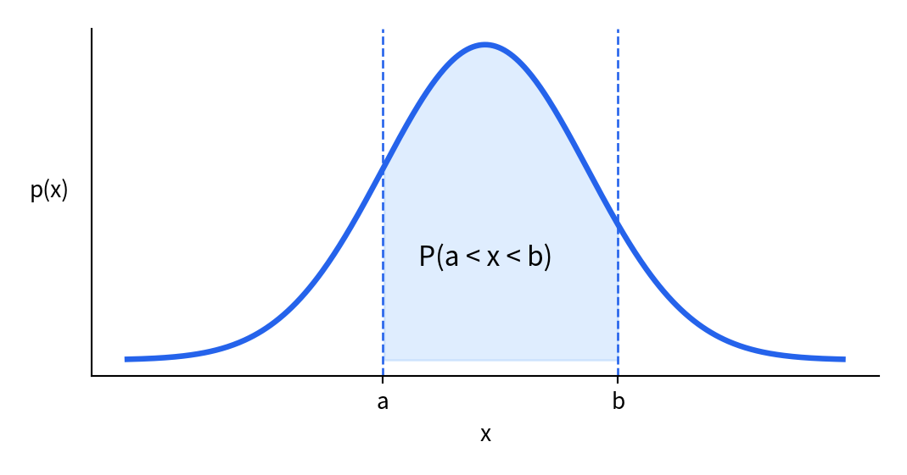
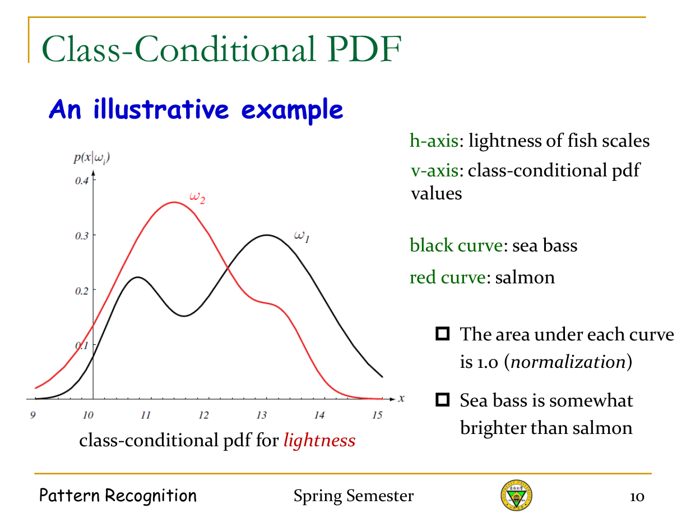
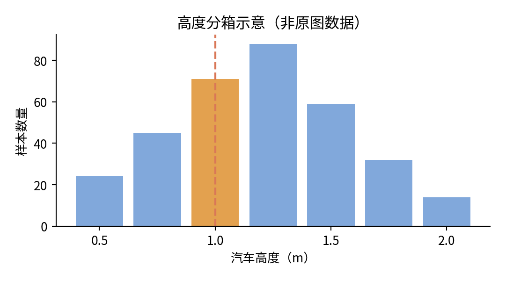
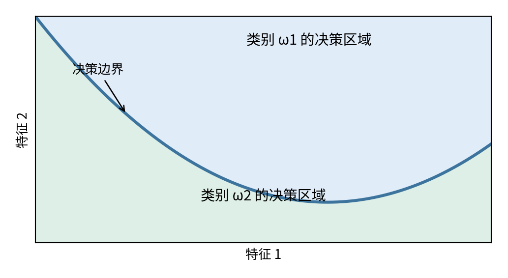
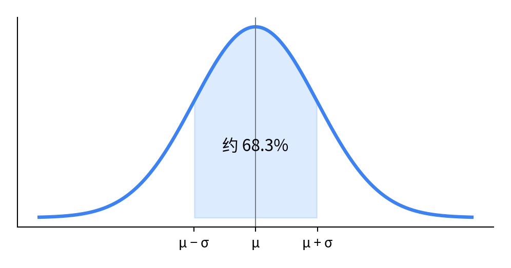
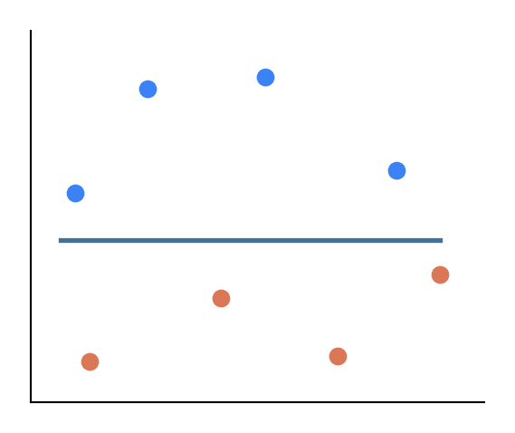
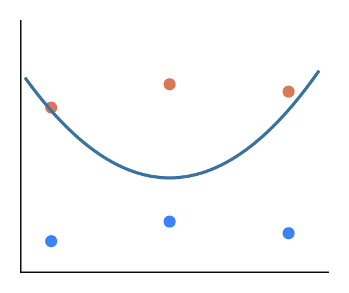
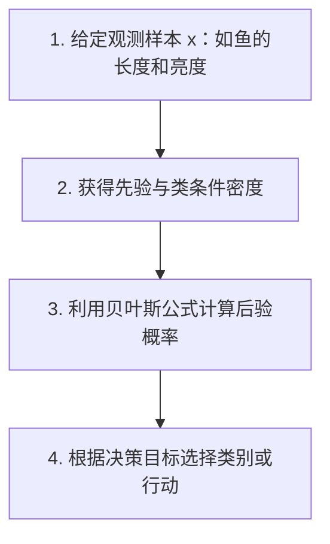

# 《模式识别》第二章：贝叶斯决策理论

Chapter 2 — Bayesian Decision Theory · 60 页逐页中文精讲

这章是模式识别的重要理论基础。考虑到你目前基础比较薄弱，我会从**概率论基础**开始，按照课件原来的顺序讲解，不默认你已经掌握条件概率、概率密度、矩阵或高斯分布。

每页统一采用：

- **① 原文中文翻译**：保留原始课件的内容、数学符号和推导结论。
- **② 概念解释**：用通俗语言解释术语、公式中的每个符号。
- **③ 理解与拓展**：补充具体例子、推导思路、图像含义和容易出错的地方。

其中，原课件的内容和我的教学补充会明确区分。对原课件中可能存在的公式或表述问题，我也会单独标注。

## 第一部分：贝叶斯决策理论的基础（第 1–16 页）

这一部分要理解的核心问题是：**当我们不知道某个样本属于哪一类时，如何利用已知信息和概率做出合理判断？**

---

### 第 1 页｜章节标题

**① 原文中文翻译**

Chapter 2 — Bayesian Decision Theory

第二章：贝叶斯决策理论

Pattern Recognition — Spring Semester

模式识别——春季学期。

**② 概念解释**

先理解两个关键词。

**模式识别（Pattern Recognition）**：根据观测到的信息，识别一个对象属于什么类别，或者具有哪些属性。

例如，我们希望计算机自动识别一张图片是猫还是狗。计算机接收到图片，提取特征，最后输出分类结果。这就是典型的模式识别问题。

**贝叶斯决策理论（Bayesian Decision Theory）**：使用概率描述不确定性，并根据概率和可能的损失选择行动的方法。

本章要回答的问题就是：

> 给定一个样本，我们并不确定它属于什么类别。怎样根据已有信息，做出数学意义上合理的决策？

---

### 第 2 页｜决策理论（Decision Theory）

**① 原文中文翻译**

决策（Decision）：在不确定性下做出选择（Make choice under uncertainty）。

模式识别（Pattern Recognition）：模式 → 类别（Pattern → Category）。

给定一个测试样本，它所属的类别是不确定的，因此我们必须做出决策。

**本质上，模式识别是一个决策过程。**

**② 概念解释**

什么叫“不确定性”？

假设你看到一条鱼，想判断它是鲈鱼还是鲑鱼。

如果只看图片，你可能认为：

$$
P(\text{鲈鱼})=0.7
$$

$$
P(\text{鲑鱼})=0.3
$$

这里的 $P$ 表示概率（Probability）。

我们并没有百分之百确定它的种类，但仍然需要输出一个结果。通常可以选择概率更高的类别。

**模式识别的基本流程**

**③ 理解与拓展**

这里需要区分两个概念：

- 分类（Classification）：判断样本属于哪一类。
- 决策（Decision）：根据已知信息选择某种行动。

分类是决策的一种特殊形式。后面我们会看到，有时除了选择类别，还可以选择“拒绝判断”或者“进一步检查”。

---

### 第 3 页｜贝叶斯决策理论（Bayesian Decision Theory）

**① 原文中文翻译**

贝叶斯决策理论是模式识别的一种统计方法。

大多数模式识别算法的基本原理，都可以追溯到贝叶斯决策理论。

基本假设（Basic Assumptions）：

1. 决策问题可以使用概率形式描述。
2. 所有相关的概率值都已知。

关键原理（Key Principle）：贝叶斯定理（Bayes Theorem）。

**② 概念解释**

为什么需要概率？

因为现实中相同的特征可能对应不同类别。

例如，一条长度为 30 cm 的鱼，可能是鲈鱼，也可能是鲑鱼。仅靠长度不能百分之百判断其种类。

所以我们希望回答：

$$
P(\text{鲈鱼}\mid\text{长度}=30)
$$

这表示：**已知鱼的长度是 30 cm，它属于鲈鱼的概率是多少？**

竖线 $\mid$ 的意思是“在……条件下”。

**③ 理解与拓展**

课件假设所有相关概率已知，这是一种理想化的理论前提。

实际机器学习中，我们往往需要根据数据估计这些概率。这也是后面第 19–23 页讨论的问题。

---

### 第 4 页｜贝叶斯定理（Bayes Theorem）

这一页是本章第一个核心公式。

**① 原文中文翻译**

贝叶斯定理：

$$
\boxed{P(H\mid X)=\frac{P(H)P(X\mid H)}{P(X)}}
$$

课件对各个符号的定义如下。

| 符号 | 中文含义 | 鱼分类的例子 |
|---|---|---|
| $X$ | 观测样本，也称证据 | 鱼的长度 |
| $H$ | 假设 | 这条鱼是鲑鱼 |
| $P(H)$ | 先验概率 | 捕获鲑鱼的概率 |
| $P(X\mid H)$ | 似然 | 已知是鲑鱼，观察到该长度的可能性 |
| $P(X)$ | 证据概率 | 观察到该长度的总体可能性 |
| $P(H\mid X)$ | 后验概率 | 已知长度后，是鲑鱼的概率 |

课件右侧介绍了托马斯·贝叶斯（Thomas Bayes，1702–1761）。

**② 概念解释**

这六个符号不需要一次全部死记，重点理解三个概念。

**先验概率（Prior Probability）**

还没有看到鱼的时候，我们原本认为它属于某个类别的概率。

例如：

$$
P(H)=0.3
$$

即随机抓到一条鲑鱼的概率是 30%。

**似然（Likelihood）**

假设这条鱼确实是鲑鱼，那么观察到它具有某种长度的可能性有多大？

这是：

$$
P(X\mid H)
$$

注意这里是“已知类别，研究特征”。

**后验概率（Posterior Probability）**

我们已经看到鱼的长度，反过来推断它是鲑鱼的概率。

这是：

$$
P(H\mid X)
$$

注意这里是“已知特征，推断类别”。

**贝叶斯公式的直观关系**

新证据用于更新原来的判断。

**③ 从零开始做一个计算**

假设：

$$
P(H)=0.3,\qquad P(X\mid H)=0.8
$$

并且：

$$
P(X)=0.4
$$

那么：

$$
P(H\mid X)=\frac{0.3\times0.8}{0.4}=0.6
$$

也就是说，在观察之前，我们认为是鲑鱼的概率只有 30%；看到相应特征之后，概率提高到了 60%。

这就是**通过证据更新原有判断**。

注意：本页用的是概率形式。以后遇到连续特征时，计算公式中通常要使用概率密度 $p(x\mid H)$，不能把某个精确连续数值的密度直接当成概率。

---

### 第 5 页｜具体实例：自然状态（State of Nature）

**① 原文中文翻译**

自然状态指未来可能发生的事件。

例如：传送带上下一条到来的鱼。

自然状态不可预测，例如我们很难预先知道下一条鱼是什么种类。

从统计和概率角度来看，自然状态最好被视为一个随机变量。

设：

$$
\omega_1=\text{鲈鱼（Sea bass）}
$$

$$
\omega_2=\text{鲑鱼（Salmon）}
$$

用离散随机变量 $\omega$ 表示鱼所属的类别。

**② 概念解释**

**随机变量（Random Variable）** 是什么？

你可以把它理解为一个值尚未确定、但有可能出现不同结果的变量。

例如掷骰子：

$$
X\in\{1,2,3,4,5,6\}
$$

随机变量 $X$ 可能取六个值。

类似地，鱼的类别变量满足：

$$
\omega\in\{\omega_1,\omega_2\}
$$

两种可能的结果分别是鲈鱼和鲑鱼。

为什么使用希腊字母 $\omega$？

它只是数学符号。模式识别课程通常使用 $\omega_i$ 表示第 $i$ 个类别，不存在特殊的计算含义。

**③ 记忆重点**

以后遇到：

$$
\omega_1,\omega_2,\ldots,\omega_c
$$

就理解为第 1 类、第 2 类、一直到第 $c$ 类。

其中 $c$ 是类别总数。

---

### 第 6 页｜先验概率（Prior Probability）

**① 原文中文翻译**

先验概率是反映我们对随机变量已有知识的概率分布。

对于具有 $c$ 种自然状态的离散随机变量 $\omega$，其概率分布需要满足：

$$
P(\omega_i)\geq0
$$

以及：

$$
\boxed{\sum_{i=1}^{c}P(\omega_i)=1}
$$

分别称为非负性（Non-negativity）和归一化（Normalization）。

如果捕获的鲈鱼和鲑鱼数量相同：

$$
P(\omega_1)=P(\omega_2)=\frac12
$$

如果捕获的鲈鱼数量更多：

$$
P(\omega_1)=\frac23,\qquad P(\omega_2)=\frac13
$$

**② 概念解释**

先解释求和符号：

$$
\sum_{i=1}^{c}P(\omega_i)
$$

读作：“从 $i=1$ 到 $i=c$，把每个类别的概率加起来。”

例如三个类别：

$$
P(\omega_1)=0.2,\quad P(\omega_2)=0.3,\quad P(\omega_3)=0.5
$$

那么：

$$
0.2+0.3+0.5=1
$$

为什么必须等于 1？

因为假设所有可能类别已经完整列出，那么样本必然属于其中某个类别。

**③ 理解与拓展**

如果实际统计了 1000 条鱼，其中 700 条是鲈鱼、300 条是鲑鱼，那么可以估计：

$$
P(\omega_1)=\frac{700}{1000}=0.7
$$

$$
P(\omega_2)=\frac{300}{1000}=0.3
$$

这是一种通过历史频率估计先验概率的方式。

---

### 第 7 页｜观察前的决策（Decision Before Observation）

**① 原文中文翻译**

问题：已知先验概率，但不允许进行观测，如何判断下一条到来的鱼是什么种类？

朴素决策规则（Naive Decision Rule）：

$$
\boxed{
\begin{cases}
\text{判为 }\omega_1,&P(\omega_1)>P(\omega_2)\\
\text{判为 }\omega_2,&\text{其他情况}
\end{cases}
}
$$

课件指出：

- 在没有观测信息时，这是能够采取的最好方法。
- 固定的先验概率意味着始终做出相同的决策。
- 当两个先验概率差别很大时，效果较好。
- 当两个先验概率接近时，效果较差。
- 两个类别概率均为 0.5 时，正确概率只有 50%。

因此，需要**把观测信息加入决策过程**。

**② 概念解释**

假设：

$$
P(\omega_1)=0.9,\quad P(\omega_2)=0.1
$$

如果完全无法观察鱼的特征，那么永远选择鲈鱼是合理的。

但是，如果两个概率是：

$$
P(\omega_1)=0.51,\quad P(\omega_2)=0.49
$$

即使全部预测为鲈鱼，也只有 51% 的平均正确率。

**③ 理解与拓展**

这说明一个重要道理：

仅使用历史统计信息，无法针对某个具体样本做出精细判断。

因此后面要引入特征 $x$，例如长度、颜色和重量。

---

### 第 8 页｜概率密度函数（Probability Density Function，PDF）

**① 原文中文翻译**

对于取值属于实数集合 $\mathbb R$ 的连续随机变量 $x$，定义概率密度函数 $p(x)$。

它满足：

$$
p(x)\geq0
$$

以及：

$$
\boxed{\int_{-\infty}^{+\infty}p(x)\,dx=1}
$$

对于连续随机变量，讨论它恰好等于某个具体数值的概率通常没有实际意义，因为该概率几乎总是零。

因此，我们研究随机变量落入某个区间的概率。

对于 $R=(a,b)$：

$$
\boxed{P(x\in R)=\int_a^b p(x)\,dx}
$$

**② 概念解释**

这是概率论中非常重要的一页。

先对比离散变量和连续变量。

**离散随机变量**：例如掷骰子的结果只有 1、2、3、4、5、6。

我们可以直接讨论：

$$
P(X=3)=\frac16
$$

**连续随机变量**：例如一个人的身高，可以是 170 cm、170.1 cm、170.12 cm，也可以继续增加小数位。

因此通常不能讨论“身高恰好为无限精度的 170 cm”的非零概率。

相反，我们可以问：

“身高位于 170–175 cm 的概率是多少？”

这就需要积分。

**概率密度曲线示意：阴影面积表示区间概率**

图示中：

- 横轴 $x$：随机变量的取值。
- 纵轴 $p(x)$：概率密度。
- 曲线下方的总面积：1。
- 从 $a$ 到 $b$ 的曲线下面积：该区间的概率。

**③ 理解与拓展**

积分可以暂时理解成“把一小块一小块的面积加起来”。

例如假设 $x$ 在 0 到 10 之间均匀分布：

$$
p(x)=0.1,\qquad 0\leq x\leq10
$$

求 $x$ 在 2 到 5 之间的概率：

$$
P(2\leq x\leq5)=\int_2^5 0.1\,dx
$$

因为图形是一个长方形：

$$
=0.1\times(5-2)=0.3
$$

所以概率是 30%。

需要记住：**概率密度不是概率，密度值本身甚至可以大于 1，但区间积分得到的概率不能大于 1。**

---

### 第 9 页｜引入观测信息（Incorporate Observations）

**① 原文中文翻译**

问题：假设已经观察到鱼的亮度测量值 $x$，怎样把这一信息用于分类？

引入类条件概率密度函数（Class-conditional Probability Density Function）：

$$
p(x\mid\omega)
$$

它表示已知自然状态（类别）为 $\omega$ 时，变量 $x$ 的概率密度函数。

满足：

$$
p(x\mid\omega)\geq0
$$

$$
\int_{-\infty}^{+\infty}p(x\mid\omega)\,dx=1
$$

类条件概率密度描述不同类别下观测值分布的差异，因此通常有：

$$
p(x\mid\omega_1)\neq p(x\mid\omega_2)
$$

**② 概念解释**

这里非常容易混淆：

$$
p(x\mid\omega_1)
$$

和：

$$
P(\omega_1\mid x)
$$

**前者**：已知鱼是鲈鱼，它出现某种亮度的密度是多少？

**后者**：已经看到某种亮度，它是鲈鱼的概率是多少？

条件的位置不一样，研究的问题就不同。

**③ 理解与拓展**

以两种鱼为例：

鲈鱼通常更亮，鲑鱼通常更暗。

所以对于较高的亮度 $x$，可能出现：

$$
p(x\mid\omega_1)>p(x\mid\omega_2)
$$

这说明该亮度在鲈鱼群体中相对更常见。

但**类条件密度更大，不一定意味着后验概率更大**，还需要结合先验概率。这正是贝叶斯决策的意义。

---

### 第 10 页｜类条件概率密度图像（Class-Conditional PDF）

**① 原文中文翻译**

课件提供了一个示意实例：

- 横轴：鱼鳞亮度。
- 纵轴：类条件概率密度函数值。
- 黑色曲线：鲈鱼。
- 红色曲线：鲑鱼。
- 每条曲线下面积都等于 1，满足归一化条件。
- 鲈鱼通常比鲑鱼更亮。

**② 图像解读**

以原课件第 10 页的图为准：它的两条曲线并不完全分开，说明**不同类别的特征分布存在重叠**。

这也是为什么单独观察亮度不能保证每次都正确分类。

例如：

对于某个较亮的观测值 $x$，黑色曲线高于红色曲线，说明这一亮度在鲈鱼群体中的概率密度更高。

但在另一些亮度区域，两条曲线接近，分类就更困难。

**③ 概念拓展**

你应该理解的是：

在机器学习中，一个类别通常不是只有一个固定特征值，而是存在一个特征的概率分布。

这也解释了为什么模式识别要研究数据分布，而不能简单地给每个类别规定一个固定值。

---

### 第 11 页｜观察后的决策（Decision After Observation）

**① 原文中文翻译**

课件列出三个已知条件：

1. 先验概率 $P(\omega_j)$。
2. 类条件概率密度 $p(x\mid\omega_j)$。
3. 测试样本的观测值 $x^*$，例如鱼的亮度。

我们希望求出未知的：

$$
P(\omega_j\mid x^*)
$$

即利用观测信息得到的后验概率。

通过贝叶斯公式，可以把先验概率转换成后验概率。

**② 概念解释**

核心计算流程如下：

$$
\boxed{
\underbrace{P(\omega_j)}_{\text{先验}}
+
\underbrace{p(x\mid\omega_j)}_{\text{似然}}
\longrightarrow
\underbrace{P(\omega_j\mid x)}_{\text{后验}}
}
$$

这里的加号只表示两种信息共同参与计算，不是说直接把两个数字相加。

真正计算时，先验和似然需要相乘，再除以归一化因子。

**③ 记忆方法**

先验：观察之前的认识。

似然：观测数据在不同类别下出现的可能性。

后验：观察之后更新的认识。

---

### 第 12 页｜重新理解贝叶斯公式（Bayes Formula Revisited）

**① 原文中文翻译**

本页引入联合概率密度（Joint Probability Density）和边缘分布（Marginal Distribution）。

联合分布：

$$
p(\omega,x)
$$

边缘分布：

$$
P(\omega)=\int_{-\infty}^{+\infty}p(\omega,x)\,dx
$$

$$
p(x)=\sum_{j=1}^{c}p(\omega_j,x)
$$

由联合分布的两种表示方式：

$$
p(\omega,x)=P(\omega\mid x)p(x)
$$

$$
p(\omega,x)=P(\omega)p(x\mid\omega)
$$

得到：

$$
P(\omega\mid x)p(x)=P(\omega)p(x\mid\omega)
$$

因此：

$$
\boxed{
P(\omega\mid x)=
\frac{p(x\mid\omega)P(\omega)}{p(x)}
}
$$

**② 概念解释**

**联合分布**：同时考虑两个变量的情况。

例如“鱼是鲈鱼，而且亮度落在某个区间”。

**边缘分布**：只关注其中一个变量，不再区分另一个变量的具体取值。

例如“观察到某种亮度”，不管鱼是哪一类。

对于所有类别：

$$
\boxed{
p(x)=\sum_{j=1}^{c}p(x\mid\omega_j)P(\omega_j)
}
$$

这就是在当前场景下的全概率公式（Law of Total Probability）。

**③ 两类问题的完整写法**

如果只有鲈鱼和鲑鱼：

$$
p(x)=p(x\mid\omega_1)P(\omega_1)
+p(x\mid\omega_2)P(\omega_2)
$$

所以：

$$
\boxed{
P(\omega_1\mid x)=
\frac{p(x\mid\omega_1)P(\omega_1)}
{p(x\mid\omega_1)P(\omega_1)+p(x\mid\omega_2)P(\omega_2)}
}
$$

这个完整表达式值得认真掌握，后面的计算题会反复使用。

---

### 第 13 页｜贝叶斯决策规则（Bayes Decision Rule）

**① 原文中文翻译**

对于 $c$ 个类别：

$$
P(\omega_j\mid x)
=\frac{p(x\mid\omega_j)P(\omega_j)}{p(x)}
$$

贝叶斯决策规则：

如果：

$$
P(\omega_j\mid x)>P(\omega_i\mid x)
\qquad \forall i\neq j
$$

则判定样本属于 $\omega_j$。

课件说明：

先验概率 $P(\omega_j)$ 和类条件密度 $p(x\mid\omega_j)$ 假设已知。

在比较各类别后验概率大小时，$p(x)$ 只是归一化因子，不影响最终分类结果。

其中：

$$
p(x)=\sum_{j=1}^{c}p(x\mid\omega_j)P(\omega_j)
$$

**② 概念解释**

为什么可以去掉分母？

假设：

$$
P(\omega_1\mid x)=\frac{0.24}{0.4}=0.6
$$

$$
P(\omega_2\mid x)=\frac{0.16}{0.4}=0.4
$$

因为两个分母相同，直接比较：

$$
0.24>0.16
$$

就已经能够确定哪个后验概率更大。

因此分类时可以使用：

$$
\boxed{
\omega^*=\arg\max_{\omega_i}
p(x\mid\omega_i)P(\omega_i)
}
$$

其中 $\arg\max$ 表示“使表达式取得最大值的那个类别”。

**③ 注意事项**

去掉 $p(x)$ 只适用于比较类别大小。

如果题目要求你**计算准确的后验概率数值**，则必须保留分母并归一化。

此外，这条最大后验概率决策规则对应后面要讲的等错误代价（0-1 损失）分类情形。

---

### 第 14 页｜贝叶斯公式的两种特殊情况

**① 原文中文翻译**

贝叶斯公式：

$$
P(\omega_j\mid x)
=\frac{p(x\mid\omega_j)P(\omega_j)}{p(x)}
$$

情况一：所有类别先验概率相等。

$$
P(\omega_1)=P(\omega_2)=\cdots=P(\omega_c)=\frac1c
$$

此时分类结果由似然决定。

情况二：所有类别在给定观测 $x$ 处的似然相等。

$$
p(x\mid\omega_1)=p(x\mid\omega_2)=\cdots=p(x\mid\omega_c)
$$

此时分类退化为只使用先验概率的朴素决策规则。

通常，贝叶斯决策需要同时考虑先验概率和似然函数。

**② 概念解释**

第一种情况可以理解为：

我们原本认为所有类别出现的机会相同。

那么看到数据之后，哪一类更容易产生当前观测，就更倾向于选择哪一类。

第二种情况可以理解为：

当前观测无法帮助区分类别，因为各类对它的解释能力一样。

那么只能继续依赖原来的先验信息。

**③ 考试记忆**

$$
\boxed{\text{后验}\propto\text{先验}\times\text{似然}}
$$

符号 $\propto$ 表示“成正比”。

这是贝叶斯分类最值得记住的关系之一。

---

### 第 15 页｜鱼分类实例：已知先验和似然

**① 原文中文翻译**

课件沿用鱼鳞亮度的类条件概率密度图像。

定义：

$$
\omega_1=\text{鲈鱼},\qquad
\omega_2=\text{鲑鱼}
$$

先验概率：

$$
P(\omega_1)=\frac23
$$

$$
P(\omega_2)=\frac13
$$

问题：

两种鱼各自的后验概率曲线应该是什么样的？

**② 概念解释**

我们现在有两种信息。

一是先验概率：鲈鱼出现得更频繁，概率为 $2/3$。

二是亮度分布：鲈鱼和鲑鱼在不同亮度下具有不同的概率密度。

因此：

$$
P(\omega_1\mid x)=
\frac{\frac23 p(x\mid\omega_1)}
{\frac23p(x\mid\omega_1)+\frac13p(x\mid\omega_2)}
$$

$$
P(\omega_2\mid x)=
\frac{\frac13 p(x\mid\omega_2)}
{\frac23p(x\mid\omega_1)+\frac13p(x\mid\omega_2)}
$$

**③ 理解与拓展**

即使某个亮度值下，鲑鱼的似然略大于鲈鱼的似然，鲈鱼仍有可能因为先验概率较高而获得更大的后验概率。

所以：

**最大似然分类（Maximum Likelihood）和最大后验分类（Maximum A Posteriori，MAP）并不总是相同。**

当先验概率相等时，两者才会给出相同的类别选择（假设并列情况处理一致）。

---

### 第 16 页｜鱼分类实例：后验概率曲线

**① 原文中文翻译**

课件展示了两种鱼的后验概率曲线。

横轴：鱼鳞亮度。

纵轴：鱼属于某一类别的后验概率。

黑色曲线：鲈鱼。

红色曲线：鲑鱼。

对于每个亮度值 $x$：

1. 较高的曲线决定贝叶斯分类输出。
2. 两条后验概率曲线的值加起来等于 1。

即：

$$
\boxed{
P(\omega_1\mid x)+P(\omega_2\mid x)=1
}
$$

**② 概念解释**

假设亮度为 $x=12$ 时：

$$
P(\omega_1\mid x)=0.7
$$

$$
P(\omega_2\mid x)=0.3
$$

那么选择鲈鱼。

如果在另一个亮度：

$$
P(\omega_1\mid x)=0.4
$$

$$
P(\omega_2\mid x)=0.6
$$

那么选择鲑鱼。

第 16 页原图中，两条曲线在某些位置相交。

交点附近意味着：

$$
P(\omega_1\mid x)=P(\omega_2\mid x)
$$

这些位置就是后面将学习的决策边界在一维情况下的表现。

**③ 理解与拓展**

类条件密度曲线和后验概率曲线的纵轴含义不同。

前者是密度，单条曲线的总面积为 1。

后者是条件概率，在每一个固定的 $x$ 位置，所有类别的后验概率之和为 1。

千万不要把这两个归一化条件混为一谈。

---

## 第二部分：贝叶斯公式的实际应用（第 17–24 页）

接下来开始做具体计算，重点是怎样把先验概率、似然和后验概率联系起来。

---

### 第 17 页｜医学检测实例（Another Example）

**① 原文中文翻译**

一种新的医学检测用于判断患者是否患有某种癌症。

检测结果只有两种：

$$
x\in\{+,-\}
$$

即阳性（Positive）或阴性（Negative）。

已知：

患病者得到阳性结果的概率为 0.98。

未患病者得到阴性结果的概率为 0.97。

任意一个人患有这种癌症的概率为 0.008。

问题：如果某人的检测结果为阳性，那么他是否患有这种癌症？

**② 概念解释**

先把题目翻译成数学符号。

设：

$$
\omega_1=\text{患癌症}
$$

$$
\omega_2=\text{未患癌症}
$$

先验概率：

$$
P(\omega_1)=0.008
$$

$$
P(\omega_2)=0.992
$$

对于患病者，阳性检测概率：

$$
P(+\mid\omega_1)=0.98
$$

对于健康者，阴性检测概率：

$$
P(-\mid\omega_2)=0.97
$$

由互补概率得到：

$$
P(+\mid\omega_2)=1-0.97=0.03
$$

**③ 新概念拓展**

这个例子也涉及医学统计中的两个术语：

**灵敏度（Sensitivity）**：真正患病的人中，检测呈阳性的比例。本题为 98%。

**特异度（Specificity）**：真正未患病的人中，检测呈阴性的比例。本题为 97%。

这个例子的目的不是评估某个真实检测项目，而是说明为什么不能把阳性检测概率直接当成阳性后的患病概率。

---

### 第 18 页｜医学检测实例：完整计算

**① 原文中文翻译**

课件列出：

$$
P(\omega_1)=0.008,\quad P(\omega_2)=0.992
$$

$$
P(+\mid\omega_1)=0.98,\quad P(+\mid\omega_2)=0.03
$$

根据贝叶斯公式：

$$
P(\omega_1\mid+)=
\frac{P(\omega_1)P(+\mid\omega_1)}
{P(\omega_1)P(+\mid\omega_1)+P(\omega_2)P(+\mid\omega_2)}
$$

代入：

$$
=\frac{0.008\times0.98}
{0.008\times0.98+0.992\times0.03}
$$

得到：

$$
\boxed{P(\omega_1\mid+)=0.2085}
$$

因此：

$$
\boxed{P(\omega_2\mid+)=0.7915}
$$

课件的分类结论是未患癌症。

**② 概念解释**

这个结果非常重要。

虽然检测的灵敏度达到 98%，但是对于一个阳性的人：

| 结果 | 后验概率 |
|---|---:|
| 阳性后患病概率 | **20.85%** |
| 阳性后未患病概率 | **79.15%** |

为什么会这样？

因为疾病非常罕见。即使健康人检测错误的概率只有 3%，由于健康人数量很大，仍然会产生不少假阳性。

**③ 再用人数解释一次**

假设有 100,000 人参加检测。

患病人数：

$$
100000\times0.008=800
$$

其中真正检测阳性的人：

$$
800\times0.98=784
$$

未患病人数：

$$
100000-800=99200
$$

其中错误检测为阳性的人：

$$
99200\times0.03=2976
$$

因此总阳性人数为：

$$
784+2976=3760
$$

真正患病的人占所有阳性者的比例：

$$
\frac{784}{3760}\approx20.85\%
$$

这与贝叶斯公式完全一致。

**注意**：课件的“未患癌症”是等错误代价下的概率分类结论，不表示医学上可以据此排除疾病。真实诊疗还需要进一步检查，且漏诊和误诊的代价并不相同。

---

### 第 19 页｜贝叶斯公式的可行性（Feasibility of Bayes Formula）

**① 原文中文翻译**

要计算后验概率：

$$
P(\omega\mid x)=\frac{p(x\mid\omega)P(\omega)}{p(x)}
$$

需要知道：

先验概率：

$$
P(\omega)
$$

以及似然：

$$
p(x\mid\omega)
$$

问题是：我们怎样知道这些概率？

课件给出两个方法：

1. 简单方法：统计相对频率（Counting Relative Frequencies）。
2. 更高级的方法：概率密度估计（Density Estimation）。

**② 概念解释**

这页开始从理论进入实际应用。

贝叶斯公式已经给出了，但现实中的数据分布通常未知。

例如我们知道有两种鱼，却不知道：

$$
P(\omega_1)=?
$$

$$
p(x\mid\omega_1)=?
$$

怎样得到这些数值？

最直接的方法就是收集大量样本，观察各个类别出现了多少次，以及各类样本的特征如何分布。

**③ 理解与拓展**

这里涉及机器学习中的统计估计思想：

数据样本 → 估计数据分布 → 利用分布进行预测。

以后学习参数估计、最大似然估计、核密度估计时，都会再次遇到这一思想。

---

### 第 20 页｜进一步实例：根据汽车高度判断价格

**① 原文中文翻译**

问题：根据某校园里一辆汽车的高度，判断它的价格是否超过 50,000 美元。

定义：

$$
\omega_1:\text{价格}>50000
$$

$$
\omega_2:\text{价格}\leq50000
$$

$$
x:\text{汽车高度}
$$

比较：

$$
P(\omega_1\mid x)
$$

和：

$$
P(\omega_2\mid x)
$$

需要知道：

$$
P(\omega_1),\quad P(\omega_2)
$$

$$
p(x\mid\omega_1),\quad p(x\mid\omega_2)
$$

这些数值可以根据收集到的样本，通过统计相对频率得到。

**② 概念解释**

为什么可以通过汽车高度预测价格？

因为不同价位的汽车，其高度分布可能不同。

但要注意，这并不是说汽车越高就一定越贵，也不是说越矮一定越贵。

模式识别研究的是统计规律，而不是绝对规律。

例如，如果某种高度在昂贵汽车中更常见，那么这个高度就提供了支持“昂贵汽车”类别的证据。

**③ 理解与拓展**

这个例子也是一个典型的监督分类问题。

已收集数据包括：

$$
(\text{汽车高度},\text{汽车是否超过 5 万美元})
$$

前者是特征（Feature），后者是类别标签（Label）。

我们希望利用带标签的历史数据，对新汽车做出预测。

### 第 21 页｜汽车案例：通过样本估计先验概率

**① 原文中文翻译**

假设从校园中随机选择了 1209 辆汽车，向车主获取价格，并测量汽车高度。

其中：

价格超过 50,000 美元的汽车有 221 辆。

价格不超过 50,000 美元的汽车有 988 辆。

计算：

$$
P(\omega_1)=\frac{221}{1209}=0.183
$$

$$
P(\omega_2)=\frac{988}{1209}=0.817
$$

**② 概念解释**

这就是通过统计样本中的相对频率估计先验概率。

一般公式为：

$$
\boxed{P(\omega_i)\approx\frac{N_i}{N}}
$$

其中：

$N$：样本总数量。

$N_i$：属于第 $i$ 类的样本数量。

例如：

$$
\frac{221}{1209}\approx18.3\%
$$

表示所收集的汽车中，价格超过 5 万美元的比例约为 18.3%。

**③ 理解与拓展**

这里的“随机抽样”非常重要。

如果只在豪华车停车区采集汽车，那么统计得到的先验概率可能远高于整个校园的真实比例。

因此，**采样方式会影响概率估计，进而影响分类结果**。

---

### 第 22 页｜汽车案例：估计类条件概率密度

**① 原文中文翻译**

需要计算：

$$
p(x\mid\omega_1),\quad p(x\mid\omega_2)
$$

方法：将汽车高度范围（例如 0.5–2.5 m）划分为 20 个区间，每个区间宽度为 0.1 m。

然后分别统计每个类别中，落在相应区间的汽车数量。

假设汽车高度为：

$$
x=1.05\text{ m}
$$

属于区间：

$$
I_x=[1.0,1.1]\text{ m}
$$

其中：

超过 5 万美元的汽车有 46 辆落在该区间。

不超过 5 万美元的汽车有 59 辆落在该区间。

课件给出：

$$
\frac{46}{221}=0.2081
$$

$$
\frac{59}{988}=0.0597
$$

**② 概念解释**

这里采用的是一种直方图（Histogram）统计方法。

简单理解就是：

先把连续的高度划分为一个个小格子，再统计每个格子里有多少辆汽车。

**高度分箱示意（非原图数据）**

**③ 重要的数学细节**

原课件将 0.2081 和 0.0597 写成 $p(x\mid\omega_i)$，但严格来说，直接使用区间计数得到的是**区间概率**，不是连续概率密度。

真正的直方图密度估计还需要除以区间宽度：

$$
\hat p(1.05\mid\omega_1)
=\frac{46}{221\times0.1}
\approx2.081
$$

$$
\hat p(1.05\mid\omega_2)
=\frac{59}{988\times0.1}
\approx0.597
$$

这里的密度数值大于 1 并不奇怪，因为概率密度本来就不必小于 1。

不过，在下一页的分类比值中，两类使用了相同的区间宽度 0.1，因此公共因子会抵消，原课件的分类结果仍然成立。

---

### 第 23 页｜汽车案例：完整的贝叶斯分类

**① 原文中文翻译**

问题：高度为 1.05 m 的汽车，价格是否超过 50,000 美元？

已估计：

$$
P(\omega_1)=0.183,\quad P(\omega_2)=0.817
$$

$$
\hat q_1=0.2081,\quad \hat q_2=0.0597
$$

其中 $\hat q_1,\hat q_2$ 是上一页对应区间的频率估计。

课件计算：

$$
\frac{P(\omega_2\mid x)}{P(\omega_1\mid x)}
=\;
\frac{P(\omega_2)p(x\mid\omega_2)}
{P(\omega_1)p(x\mid\omega_1)}
$$

代入课件数值：

$$
=\frac{0.817\times0.0597}
{0.183\times0.2081}
$$

得到：

$$
\boxed{\frac{P(\omega_2\mid x)}{P(\omega_1\mid x)}\approx1.280}
$$

因此：

$$
P(\omega_2\mid x)>P(\omega_1\mid x)
$$

结论：价格不超过 50,000 美元。

**② 概念解释**

为什么没有计算两个后验概率的具体数值？

因为题目只需要判断类别，所以比较比值即可。

若：

$$
\frac{P(\omega_2\mid x)}{P(\omega_1\mid x)}>1
$$

则选择 $\omega_2$。

若小于 1，则选择 $\omega_1$。

**③ 进一步计算**

如果希望得到具体概率，根据两类概率之和为 1：

$$
P(\omega_1\mid x)=\frac{1}{1+1.280}\approx0.439
$$

$$
P(\omega_2\mid x)=\frac{1.280}{1+1.280}\approx0.561
$$

即价格不超过 5 万美元的后验概率约为 56.1%。

所以这次判断虽然有优势，但并不特别确定。

---

### 第 24 页｜贝叶斯决策规则是否最优？

**① 原文中文翻译**

对于二分类问题：

如果：

$$
P(\omega_1\mid x)>P(\omega_2\mid x)
$$

则选择 $\omega_1$，否则选择 $\omega_2$。

观察到某个 $x$ 时，错误概率为：

$$
P(\text{error}\mid x)=
\begin{cases}
P(\omega_1\mid x),&\text{选择 }\omega_2\\
P(\omega_2\mid x),&\text{选择 }\omega_1
\end{cases}
$$

使用贝叶斯决策规则：

$$
\boxed{
P(\text{error}\mid x)
=\min\{P(\omega_1\mid x),P(\omega_2\mid x)\}
}
$$

对于每个 $x$，错误概率都尽可能小。

因此，对所有可能 $x$ 求平均后，整体错误概率也尽可能小。

**② 概念解释**

假设：

$$
P(\omega_1\mid x)=0.8,\quad
P(\omega_2\mid x)=0.2
$$

如果选择 $\omega_1$，错误概率为 0.2。

如果选择 $\omega_2$，错误概率为 0.8。

显然选择 $\omega_1$ 更好。

这说明在各类分类错误的代价相同、真实后验概率已知的前提下，**选择后验概率最大的类别能够使分类错误率最小**。

**③ 理解与拓展**

注意“最优”有具体前提。

如果两种错误造成的后果不同，仅仅追求错误率最小就不一定是最合理的策略。

例如漏诊严重疾病可能比一次误报造成更大的损失。

这就需要下一部分的**风险最小化**理论。

---

## 第三部分：从最小错误率到最小风险（第 25–35 页）

这一部分是本章最重要的理论推进。

之前的分类方法只关心“判断得对不对”。

现在要进一步考虑：**判断错误会造成多大的损失？**

---

### 第 25 页｜贝叶斯决策规则的一般形式

**① 原文中文翻译**

将贝叶斯决策规则推广到更一般的情况：

第一，允许使用多个特征。

原来：

$$
x\in\mathbb R
$$

现在：

$$
\boxed{\mathbf{x}\in\mathbb R^d}
$$

其中 $\mathbb R^d$ 表示 $d$ 维欧氏空间。

第二，允许超过两个自然状态：

$$
\Omega=\{\omega_1,\omega_2,\ldots,\omega_c\}
$$

第三，允许采取的不仅仅是类别判断，还可以是其他行动：

$$
A=\{\alpha_1,\alpha_2,\ldots,\alpha_a\}
$$

课件特别指出：类别数量 $c$ 和行动数量 $a$ 不必相等。

**② 概念解释**

**特征维度（Feature Dimension）**

之前只考虑鱼的亮度：

$$
x=12.5
$$

这是一个一维特征。

如果同时考虑鱼的长度、宽度和亮度：

$$
\mathbf{x}=
\begin{bmatrix}
30\\
8\\
12.5
\end{bmatrix}
$$

这就是三维特征向量。

这里：

$$
d=3
$$

**自然状态与行动**

自然状态是客观真实的类别。

行动是我们实际做出的选择。

两者不一定一一对应。

例如真实状态只有患病和未患病两种，但行动可以有三个：

$$
\alpha_1=\text{方案A}
$$

$$
\alpha_2=\text{方案B}
$$

$$
\alpha_3=\text{不采取治疗}
$$

因此类别数量可能是 2，而行动数量是 3。

---

### 第 26 页｜损失函数（Loss Function）

**① 原文中文翻译**

引入一种比错误概率更一般的损失函数：

$$
\lambda:\Omega\times A\rightarrow\mathbb R
$$

它描述：当真实状态为 $\omega_j$，却采取行动 $\alpha_i$ 时，产生多大的损失。

课件通常写成：

$$
\boxed{\lambda(\alpha_i\mid\omega_j)}
$$

课件给出下面的损失矩阵：

| 真实状态 | 方案 A | 方案 B | 不治疗 |
|---|---:|---:|---:|
| 患癌症 | 5 | 50 | 10000 |
| 未患癌症 | 60 | 3 | 0 |

**② 概念解释**

首先要理解：**损失不等于判断错误的概率。**

例如：

在病人确实患病的情况下，不治疗会产生很大的损失，因此课件设定为 10000。

而一个未患病的人采用方案 A，也会造成不必要的损失，设定为 60。

这些是课件构造的示例损失值，不代表真实医学成本。

我们可以将整个表写成矩阵：

$$
\Lambda=
\begin{bmatrix}
5&50&10000\\
60&3&0
\end{bmatrix}
$$

行对应真实类别，列对应行动。

**③ 新概念：损失矩阵**

当错误代价不同的时候，不能简单选择“概率最大的类别”就结束。

我们需要比较不同决策造成的预期损失。

例如一个疾病发生概率虽然很低，但是漏诊代价极大，那么采取进一步检查可能仍然是合理的。

---

### 第 27 页｜为什么需要期望损失？

**① 原文中文翻译**

问题：给定观测样本 $x$，我们需要决定采取哪一种行动。

因此需要知道采取每一种行动：

$$
\alpha_i,\quad 1\leq i\leq a
$$

会产生多大损失。

如果真实状态是 $\omega_j$，采取行动 $\alpha_i$，产生的损失为：

$$
\lambda(\alpha_i\mid\omega_j)
$$

然而，真实状态是不确定的。

因此需要计算期望损失（Expected Loss）。

**② 概念解释**

为什么不能直接查损失矩阵，选择损失最小的数字？

因为我们不知道真实类别是什么。

例如在上页表格中：

不治疗对健康者的损失为 0，但对患癌者的损失为 10000。

我们不能提前确定究竟属于哪一种情况。

因此要考虑：

“在当前信息下，每种真实状态分别有多大概率？”

然后用这些概率对损失进行加权平均。

**③ 概念拓展：数学期望**

假设一个行动有两种可能结果：

- 80% 的概率损失 10。
- 20% 的概率损失 100。

平均损失是：

$$
0.8\times10+0.2\times100=28
$$

这就是期望损失的基本计算思路。

---

### 第 28 页｜期望损失与条件风险（Conditional Risk）

**① 原文中文翻译**

对全部可能的真实状态进行加权平均。

期望损失：

$$
\boxed{
R(\alpha_i\mid\mathbf{x})
=\;
\sum_{j=1}^{c}
\lambda(\alpha_i\mid\omega_j)
P(\omega_j\mid\mathbf{x})
}
$$

其中：

$$
\lambda(\alpha_i\mid\omega_j)
$$

表示真实状态为 $\omega_j$ 时，采取行动 $\alpha_i$ 的损失。

$$
P(\omega_j\mid\mathbf{x})
$$

表示给定观测 $\mathbf{x}$ 后，真实状态属于 $\omega_j$ 的概率。

期望损失也称为**条件风险（Conditional Risk）**。

**② 概念解释**

这是本章第二个必须掌握的核心公式。

将公式拆开：

$$
\underbrace{R(\alpha_i\mid\mathbf{x})}_{\text{条件风险}}
=\;
\sum_j
\underbrace{\lambda(\alpha_i\mid\omega_j)}_{\text{损失}}
\cdot
\underbrace{P(\omega_j\mid\mathbf{x})}_{\text{后验概率}}
$$

含义就是：

**把某个行动在各种真实情况下的损失，乘以相应情况出现的概率，然后全部相加。**

**③ 二分类时的简化公式**

如果只有两个类别：

$$
\boxed{
R(\alpha_i\mid x)=
\lambda(\alpha_i\mid\omega_1)P(\omega_1\mid x)
+
\lambda(\alpha_i\mid\omega_2)P(\omega_2\mid x)
}
$$

后面的计算题基本上就是使用这个公式。

---

### 第 29 页｜条件风险的实际计算

**① 原文中文翻译**

继续使用第 26 页的损失矩阵。

假设对某个观测 $x$，已经得到：

$$
P(\omega_1\mid x)=0.01
$$

$$
P(\omega_2\mid x)=0.99
$$

即患病后验概率为 1%，未患病后验概率为 99%。

对于方案 A：

$$
R(\alpha_1\mid x)
=5\times0.01+60\times0.99
$$

$$
\boxed{R(\alpha_1\mid x)=59.45}
$$

对于方案 B：

$$
R(\alpha_2\mid x)
=50\times0.01+3\times0.99
$$

$$
\boxed{R(\alpha_2\mid x)=3.47}
$$

对于不治疗：

$$
R(\alpha_3\mid x)
=10000\times0.01+0\times0.99
$$

$$
\boxed{R(\alpha_3\mid x)=100}
$$

**② 概念解释**

将三个行动放在一起：

| 行动 | 条件风险 |
|---|---:|
| 方案 A | 59.45 |
| 方案 B | 3.47 |
| 不治疗 | 100 |

所以：

$$
\boxed{\alpha^*=\alpha_2}
$$

即选择方案 B，因为它的期望损失最小。

**③ 理解与拓展**

这个例子能够说明一个关键问题：

虽然患病概率只有 1%，但由于不治疗的损失非常大，直接不治疗的期望损失达到了 100。

因此：

**最可能的真实状态，不一定对应损失最小的行动。**

---

### 第 30 页｜总体风险（Overall Risk）

**① 原文中文翻译**

任务：找到一个从模式到行动的映射。

决策函数：

$$
\alpha:\mathbb R^d\rightarrow A
$$

也就是说，对每一个特征向量 $\mathbf{x}$，决策函数 $\alpha(\mathbf{x})$ 都输出一个行动。

总体风险（Overall Risk）：

$$
\boxed{
R=\int R(\alpha(\mathbf{x})\mid\mathbf{x})p(\mathbf{x})\,d\mathbf{x}
}
$$

其中：

$$
R(\alpha(\mathbf{x})\mid\mathbf{x})
$$

是给定样本时，采取指定行动的条件风险。

$$
p(\mathbf{x})
$$

是样本特征的概率密度。

**② 概念解释**

这一页需要区分条件风险和总体风险。

**条件风险**：针对某一个具体样本，采用某个行动时的平均损失。

**总体风险**：考虑所有可能出现的样本后，分类器的平均损失。

例如，一个分类器在某些样本上做得很好，在另外一些样本上做得不好。

我们不能只看某个样本的表现，需要考虑不同样本出现的概率，并对其风险进行平均。

**③ 为什么使用积分？**

因为 $\mathbf{x}$ 是连续特征向量，可能有无限多个取值。

对所有特征取值加权平均，就需要使用积分。

如果是离散特征，则可以使用求和代替积分：

$$
R=\sum_x R(\alpha(x)\mid x)P(x)
$$

---

### 第 31 页｜一般贝叶斯决策规则

**① 原文中文翻译**

总体风险：

$$
R=\int R(\alpha(\mathbf{x})\mid\mathbf{x})p(\mathbf{x})\,d\mathbf{x}
$$

如果对每一个 $\mathbf{x}$，都保证所选择行动的条件风险最小，那么总体风险也会最小。

因此，一般贝叶斯决策规则为：

$$
\boxed{
\alpha^*(\mathbf{x})=
\arg\min_{\alpha_i\in A}
R(\alpha_i\mid\mathbf{x})
}
$$

代入条件风险公式：

$$
\boxed{
\alpha^*(\mathbf{x})
=\;
\arg\min_{\alpha_i\in A}
\sum_{j=1}^{c}
\lambda(\alpha_i\mid\omega_j)
P(\omega_j\mid\mathbf{x})
}
$$

最终得到的最小总体风险称为贝叶斯风险（Bayes Risk），记为：

$$
R^*
$$

它是在已知相关概率分布及损失函数的条件下，能够达到的最优性能。

**② 概念解释**

这里出现：

$$
\arg\min
$$

和前面学过的：

$$
\arg\max
$$

有什么不同？

$\arg\max$：寻找使目标函数最大的输入。

$\arg\min$：寻找使目标函数最小的输入。

之前我们希望选择后验概率最大的类别，所以使用 $\arg\max$。

现在我们希望选择期望损失最小的行动，所以使用 $\arg\min$。

**③ 对比理解**

| 分类目标 | 决策标准 |
|---|---|
| 最小化错误率 | 选择后验概率最大的类别 |
| 最小化预期损失 | 选择条件风险最小的行动 |

后面的第 34–35 页会证明，在 0-1 损失情况下，两种决策方式实际上是一致的。

---

### 第 32 页｜二分类问题的一般形式

**① 原文中文翻译**

考虑一个特殊情况：

$$
\Omega=\{\omega_1,\omega_2\}
$$

表示两个自然状态。

行动集合：

$$
A=\{\alpha_1,\alpha_2\}
$$

其中：

$$
\alpha_1=\text{判为 }\omega_1
$$

$$
\alpha_2=\text{判为 }\omega_2
$$

定义：

$$
\lambda_{ij}=\lambda(\alpha_i\mid\omega_j)
$$

表示真实类别是 $\omega_j$，却采取行动 $\alpha_i$ 时的损失。

两个行动的条件风险分别为：

$$
R(\alpha_1\mid x)
=\;
\lambda_{11}P(\omega_1\mid x)
+\lambda_{12}P(\omega_2\mid x)
$$

$$
R(\alpha_2\mid x)
=\;
\lambda_{21}P(\omega_1\mid x)
+\lambda_{22}P(\omega_2\mid x)
$$

如果：

$$
R(\alpha_1\mid x)<R(\alpha_2\mid x)
$$

则选择 $\omega_1$，否则选择 $\omega_2$。

**② 概念解释**

四个损失参数的含义：

| 参数 | 实际情况 | 决策结果 |
|---|---|---|
| $\lambda_{11}$ | $\omega_1$ | 正确选择 $\omega_1$ |
| $\lambda_{12}$ | $\omega_2$ | 错误选择 $\omega_1$ |
| $\lambda_{21}$ | $\omega_1$ | 错误选择 $\omega_2$ |
| $\lambda_{22}$ | $\omega_2$ | 正确选择 $\omega_2$ |

注意：**第一个下标代表采取的行动，第二个下标代表真实类别。**

这个下标顺序在计算题中很容易弄错。

---

### 第 33 页｜似然比检验（Likelihood Ratio Test）

这是本章需要认真掌握的公式推导页。

**① 原文中文翻译**

选择 $\omega_1$ 的条件：

$$
R(\alpha_1\mid x)<R(\alpha_2\mid x)
$$

展开：

$$
\lambda_{11}P(\omega_1\mid x)
+\lambda_{12}P(\omega_2\mid x)
$$

$$
<
\lambda_{21}P(\omega_1\mid x)
+\lambda_{22}P(\omega_2\mid x)
$$

整理：

$$
(\lambda_{21}-\lambda_{11})P(\omega_1\mid x)
>
(\lambda_{12}-\lambda_{22})P(\omega_2\mid x)
$$

应用贝叶斯公式后得到：

$$
\boxed{
\frac{p(x\mid\omega_1)}{p(x\mid\omega_2)}
>
\frac{\lambda_{12}-\lambda_{22}}
{\lambda_{21}-\lambda_{11}}
\frac{P(\omega_2)}{P(\omega_1)}
}
$$

课件将右侧定义为与 $x$ 无关的常数阈值 $\theta$。

**② 概念解释**

左边：

$$
\Lambda(x)=
\frac{p(x\mid\omega_1)}{p(x\mid\omega_2)}
$$

叫作**似然比（Likelihood Ratio）**。

它衡量当前样本特征相对于 $\omega_2$，更支持 $\omega_1$ 的程度。

右边：

$$
\theta=
\frac{\lambda_{12}-\lambda_{22}}
{\lambda_{21}-\lambda_{11}}
\frac{P(\omega_2)}{P(\omega_1)}
$$

叫作决策阈值。

因此规则可以简化为：

$$
\boxed{
\Lambda(x)\mathop{\gtrless}_{\omega_2}^{\omega_1}\theta
}
$$

也就是：

似然比大于阈值，选择 $\omega_1$。

似然比小于阈值，选择 $\omega_2$。

课件的这一推导假设错误决策的损失大于对应正确决策的损失，使得有关损失差值为正。

**③ 为什么这很重要？**

分类实际上可以理解为：

先计算一个反映证据强弱的分数，再将其与阈值比较。

而阈值不只取决于数据本身，还取决于：

- 先验概率；
- 不同错误造成的损失。

这正是为什么在高风险场景中，可以根据错误代价调整决策标准。

---

### 第 34 页｜最小错误率分类（Minimum-Error-Rate Classification）

**① 原文中文翻译**

分类设置：

$$
\Omega=\{\omega_1,\omega_2,\ldots,\omega_c\}
$$

$$
A=\{\alpha_1,\alpha_2,\ldots,\alpha_c\}
$$

其中 $\alpha_i$ 表示选择类别 $\omega_i$。

采用 0-1 损失函数（Zero-one Loss Function）：

$$
\boxed{
\lambda(\alpha_i\mid\omega_j)=
\begin{cases}
0,&i=j\\
1,&i\neq j
\end{cases}
}
$$

正确决策的损失为 0。

任何错误决策的损失为 1，错误代价相等。

**② 概念解释**

0-1 损失非常容易理解：

预测正确：0 分损失。

预测错误：1 分损失。

例如：

| 真实类别 | 预测类别 | 损失 |
|---|---|---:|
| 猫 | 猫 | 0 |
| 猫 | 狗 | 1 |
| 狗 | 猫 | 1 |
| 狗 | 狗 | 0 |

**③ 理解与拓展**

0-1 损失的特殊性在于：

它只关心是否判断正确，不区分不同错误的严重程度。

因此，在这种情况下，最小化期望损失就等价于最小化分类错误率。

---

### 第 35 页｜推导最小错误率决策规则

**① 原文中文翻译**

条件风险：

$$
R(\alpha_i\mid x)=
\sum_{j=1}^{c}
\lambda(\alpha_i\mid\omega_j)P(\omega_j\mid x)
$$

对于 0-1 损失：

$$
=\sum_{j\neq i}P(\omega_j\mid x)
$$

因为全部后验概率之和为 1：

$$
\sum_{j=1}^{c}P(\omega_j\mid x)=1
$$

所以：

$$
\boxed{
R(\alpha_i\mid x)=1-P(\omega_i\mid x)
}
$$

即采取行动 $\alpha_i$ 时的分类错误概率。

因此，最小错误率决策规则为：

$$
\boxed{
\text{选择 }\omega_i
\quad\text{当}\quad
P(\omega_i\mid x)>P(\omega_j\mid x),\ \forall j\neq i
}
$$

**② 逐步理解**

我们希望：

$$
\min_i R(\alpha_i\mid x)
$$

代入：

$$
=\min_i[1-P(\omega_i\mid x)]
$$

由于 1 是常数，要让整个表达式最小，就必须让后验概率最大。

所以：

$$
\boxed{
\arg\min_i[1-P(\omega_i\mid x)]
=\;
\arg\max_i P(\omega_i\mid x)
}
$$

这就从一般贝叶斯最小风险决策，推导出了前面介绍的最大后验概率分类规则。

**③ 本部分最重要的结论**

最大后验概率决策并不是完全独立于最小风险决策的另一套理论。

它实际上是**采用 0-1 损失函数时，最小风险决策的特殊情况**。

---

## 第四部分：极小化极大准则（第 36–40 页）

这一部分比之前抽象一些。先理解它解决什么问题，再看数学公式。

### 第 36 页｜极小化极大准则（Minimax Criterion）

**① 原文中文翻译**

通常我们假设自然状态的先验概率：

$$
\Omega=\{\omega_1,\omega_2,\ldots,\omega_c\}
$$

是固定的。

但是在某些情况下，需要设计能够在先验概率变化时仍然表现良好的分类器。

例如，在不同地区，捕获鲈鱼和鲑鱼的先验概率可能不同。

先验概率改变，会导致总体风险改变。

极小化极大准则（Minimax Criterion）的目标是：

**在所有可能的先验概率情况下，使最坏情况下的总体风险尽可能小。**

**② 概念解释**

普通贝叶斯决策是：

已知类别分布 → 求当前分布下的最优决策。

极小化极大决策是：

先验分布可能变化 → 尽量保证最坏情况下也不会损失过大。

用数学语言表示：

$$
\boxed{
\min_{\alpha}\max_{P(\omega)}R(\alpha,P(\omega))
}
$$

意思是：

对一个给定分类器，先找最不利的先验概率分布，再选择使这种最坏风险尽可能小的分类器。

**③ 举例理解**

假设有两个分类器：

分类器 A：

在某些地区错误率 2%，但换一个地区可能达到 40%。

分类器 B：

在不同地区错误率都接近 15%。

如果目标是平均表现，A 可能更好。

但如果无法预知部署地区，且特别重视最坏表现，那么 B 可能更合适。

这体现了极小化极大准则的思想。

---

### 第 37 页｜二分类的总体风险

**① 原文中文翻译**

考虑二分类问题：

$$
\Omega=\{\omega_1,\omega_2\}
$$

$$
A=\{\alpha_1,\alpha_2\}
$$

其中：

$$
\alpha_1=\text{判为 }\omega_1
$$

$$
\alpha_2=\text{判为 }\omega_2
$$

假设分类器在区域 $R_1$ 内选择 $\omega_1$，在区域 $R_2$ 内选择 $\omega_2$。

这两个区域满足：

$$
R_1\cup R_2=\mathbb R^d
$$

$$
R_1\cap R_2=\varnothing
$$

总体风险为：

$$
R=\int R(\alpha(x)\mid x)p(x)\,dx
$$

可分解为：

$$
\boxed{
R=
\int_{R_1}R(\alpha_1\mid x)p(x)\,dx
+
\int_{R_2}R(\alpha_2\mid x)p(x)\,dx
}
$$

**② 概念解释**

这里出现两个重要概念。

**决策区域（Decision Region）**：分类器决定将某个样本划分为某一类别的特征空间区域。

例如根据鱼的亮度：

$$
x>12\Rightarrow \omega_1
$$

$$
x\leq12\Rightarrow \omega_2
$$

则：

$$
R_1=(12,+\infty)
$$

$$
R_2=(-\infty,12]
$$

注意，两个区域划分了全部特征空间。

**③ 为什么要拆成两个积分？**

因为两个区域中采取的行动不同。

在区域 $R_1$ 中使用 $\alpha_1$ 的风险。

在区域 $R_2$ 中使用 $\alpha_2$ 的风险。

分别计算并相加，就得到整个分类器的总体风险。

---

### 第 38 页｜展开总体风险公式

**① 原文中文翻译**

由上页：

$$
R=
\int_{R_1}R(\alpha_1\mid x)p(x)\,dx
+
\int_{R_2}R(\alpha_2\mid x)p(x)\,dx
$$

对第一项：

$$
\int_{R_1}R(\alpha_1\mid x)p(x)\,dx
$$

代入条件风险定义：

$$
=\int_{R_1}\sum_{j=1}^{2}
\lambda_{1j}P(\omega_j\mid x)p(x)\,dx
$$

根据贝叶斯公式：

$$
P(\omega_j\mid x)p(x)
=\;
p(x\mid\omega_j)P(\omega_j)
$$

于是：

$$
=\;
\int_{R_1}
[
\lambda_{11}P(\omega_1)p(x\mid\omega_1)
+
\lambda_{12}P(\omega_2)p(x\mid\omega_2)
] \,dx
$$

类似地，第二项为：

$$
\int_{R_2}
[
\lambda_{21}P(\omega_1)p(x\mid\omega_1)
+
\lambda_{22}P(\omega_2)p(x\mid\omega_2)
] \,dx
$$

**② 概念解释**

这一页没有引入新的概率概念，主要是在进行**公式代换**。

最关键的代换是：

$$
\boxed{
P(\omega_j\mid x)p(x)
=\;
P(\omega_j)p(x\mid\omega_j)
}
$$

为什么要这样变换？

因为我们现在希望研究的是：当先验概率 $P(\omega_j)$ 变化时，总体风险 $R$ 会如何变化。

因此要把先验概率从积分表达式中明确地提取出来。

---

### 第 39 页｜将总体风险写成先验概率的函数

**① 原文中文翻译**

继续整理：

$$
\begin{aligned}
R={}&
\int_{R_1}
[\lambda_{11}P(\omega_1)p(x\mid\omega_1)\\
&+\lambda_{12}P(\omega_2)p(x\mid\omega_2)]\,dx\\
&+
\int_{R_2}
[\lambda_{21}P(\omega_1)p(x\mid\omega_1)\\
&+\lambda_{22}P(\omega_2)p(x\mid\omega_2)]\,dx
\end{aligned}
$$

利用：

$$
P(\omega_1)=1-P(\omega_2)
$$

以及：

$$
\int_{R_1}p(x\mid\omega_j)\,dx
=\;
1-\int_{R_2}p(x\mid\omega_j)\,dx
$$

可以把总体风险整理成：

$$
\begin{aligned}
R={}&\lambda_{22}
+(\lambda_{12}-\lambda_{22})
\int_{R_1}p(x\mid\omega_2)\,dx\\
&+P(\omega_1)\Bigg[
(\lambda_{11}-\lambda_{22})\\
&\quad+(\lambda_{21}-\lambda_{11})
\int_{R_2}p(x\mid\omega_1)\,dx\\
&\quad-(\lambda_{12}-\lambda_{22})
\int_{R_1}p(x\mid\omega_2)\,dx
\Bigg]
\end{aligned}
$$

**② 概念解释**

这个公式很长，但核心结构很简单：

$$
\boxed{R=A+B\cdot P(\omega_1)}
$$

这里 $A$ 和 $B$ 在决策区域固定、类条件分布及损失函数固定时，都是常数。

因此总体风险可以写成先验概率的**一次函数**。

即：

$$
y=a+bx
$$

你在中学学过这种函数。

这里：

$$
y=R,\qquad x=P(\omega_1)
$$

所以，当分类器固定时，风险随先验概率变化形成一条直线。

**③ 为什么重要？**

后面会利用这条直线的特性分析最坏风险，以及怎样设计对先验概率不敏感的分类器。

---

### 第 40 页｜极小化极大风险的条件

**① 原文中文翻译**

课件继续使用：

$$
R=A+B P(\omega_1)
$$

的形式。

对于其讨论的极小化极大解，要求关于先验概率的线性项系数为 0。

即：

$$
\begin{aligned}
0={}&(\lambda_{11}-\lambda_{22})\\
&+(\lambda_{21}-\lambda_{11})
\int_{R_2}p(x\mid\omega_1)\,dx\\
&-(\lambda_{12}-\lambda_{22})
\int_{R_1}p(x\mid\omega_2)\,dx
\end{aligned}
$$

对应的极小化极大风险记为：

$$
\boxed{R_{mm}}
$$

课件给出两个等价表达：

$$
R_{mm}
=\;
\lambda_{22}
+
(\lambda_{12}-\lambda_{22})
\int_{R_1}p(x\mid\omega_2)\,dx
$$

以及：

$$
R_{mm}
=\;
\lambda_{11}
+
(\lambda_{21}-\lambda_{11})
\int_{R_2}p(x\mid\omega_1)\,dx
$$

课件强调，风险也可以类似地写成先验概率 $P(\omega_2)$ 的线性函数。

**② 概念解释**

为什么希望：

$$
B=0
$$

因为如果：

$$
R=A+B P(\omega_1)
$$

当 $B\neq0$ 时，风险就会随着先验概率变化。

当：

$$
B=0
$$

则：

$$
R=A
$$

风险不再受到先验概率变化的影响。

对于课件讨论的等风险构造，这样可以让最不利先验分布不再产生额外的风险变化。

**③ 深入理解**

这里需要注意一个理论细节：

“令斜率为零”是一种重要的等风险构造思路，但不能在所有极小化极大问题中，不加条件地认为它是唯一必要条件。

如果存在可实现的等风险决策规则，并且它确实达到最小的最坏风险，那么就能得到所需的极小化极大解；其他问题还可能涉及边界解或随机化决策。

对于这份课件，先理解为：

> 极小化极大准则关注最坏情况下的总体风险，课件通过构造对先验概率变化不敏感的决策规则，说明一种求解思路。

这就已经把握了这一部分的主要教学目标。

## 第五部分：判别函数与决策边界（第 41–43 页）

前面我们一直使用概率和风险进行分类。现在开始研究，如何把这些理论变成实际可计算的分类函数。

### 第 41 页｜判别函数（Discriminant Function）

**① 原文中文翻译**

分类过程：

Pattern → Category（模式 → 类别）。

分类行动与类别决策之间存在对应关系。

判别函数：

$$
\boxed{g_i:\mathbb R^d\rightarrow\mathbb R}
$$

其中：

$$
1\leq i\leq c
$$

判别函数是一种表示分类器的有效方式。

每个类别对应一个判别函数。

如果：

$$
g_i(\mathbf{x})>g_j(\mathbf{x}),\quad\forall j\neq i
$$

则判定样本属于类别 $\omega_i$。

**② 概念解释**

什么是判别函数？

简单来说，就是**给每个类别计算一个分数的函数**。

例如，假设一张图片需要区分猫、狗和兔子。

分类器为三个类别分别计算：

$$
g_1(\mathbf{x})=2.3
$$

$$
g_2(\mathbf{x})=4.5
$$

$$
g_3(\mathbf{x})=1.8
$$

其中：

$g_1$ 对应猫。

$g_2$ 对应狗。

$g_3$ 对应兔子。

因为：

$$
g_2(\mathbf{x})=\max\{2.3,4.5,1.8\}
$$

所以最终判断为狗。

**③ 与神经网络分类器的联系**

在现代深度学习中，分类网络最后经常输出一组分数：

$$
\mathbf{z}=[z_1,z_2,\ldots,z_c]
$$

这些分数称为 Logits，可以起到判别函数值的作用。

例如：

$$
\mathbf{z}=[1.2,3.5,0.8]
$$

直接选择分数最大的类别即可。

后续还可以通过 Softmax 函数把这些分数转化成归一化的概率形式。

需要注意，普通 Logits 不会天然等于真实的后验概率，需要通过模型训练和概率校准才能讨论其概率解释。

---

### 第 42 页｜不同判别函数可以产生相同分类结果

**① 原文中文翻译**

对于最小风险决策，可以选择：

$$
\boxed{g_i(\mathbf{x})=-R(\alpha_i\mid\mathbf{x})}
$$

对于最小错误率分类，可以选择：

$$
\boxed{g_i(\mathbf{x})=P(\omega_i\mid\mathbf{x})}
$$

不同形式的判别函数可以产生完全相同的分类结果。

如果 $f(\cdot)$ 是单调递增函数，那么对所有类别同时应用：

$$
f(g_i(\mathbf{x}))
$$

不会改变各类别的大小顺序。

例如：

$$
f(x)=kx,\qquad k>0
$$

或者：

$$
f(x)=\ln x
$$

其中对数变换要求输入大于零。

**② 概念解释**

假设：

$$
g_1(x)=0.8,\quad g_2(x)=0.2
$$

由于：

$$
0.8>0.2
$$

所以选择第一类。

如果同时取自然对数：

$$
\ln0.8\approx-0.223
$$

$$
\ln0.2\approx-1.609
$$

仍然满足：

$$
\ln0.8>\ln0.2
$$

因此分类结果不变。

**③ 为什么要使用对数？**

主要有两个好处。

第一，乘法可以转换成加法：

$$
\boxed{\ln(ab)=\ln a+\ln b}
$$

例如贝叶斯公式中的：

$$
p(x\mid\omega_i)P(\omega_i)
$$

取对数后：

$$
\ln p(x\mid\omega_i)+\ln P(\omega_i)
$$

第二，能够缓解大量很小的概率相乘时出现的数值下溢问题。

在机器学习和概率模型中，使用对数似然（Log-Likelihood）是非常常见的做法。

---

### 第 43 页｜决策区域和决策边界

**① 原文中文翻译**

决策区域（Decision Region）：

对于 $c$ 个判别函数，可以形成 $c$ 个决策区域。

第 $i$ 类的决策区域：

$$
\boxed{
R_i=
\{\mathbf{x}\in\mathbb R^d:
g_i(\mathbf{x})>g_j(\mathbf{x}),\ \forall j\neq i\}
}
$$

不同类别的区域不应发生内部重叠，所有区域连同决策边界覆盖整个特征空间。

决策边界（Decision Boundary）：

特征空间中，多个具有最大值的判别函数取值相等的位置形成的边界。

**② 概念解释**

假设我们使用两个特征描述鱼：

$$
\mathbf{x}=
\begin{bmatrix}
\text{长度}\\
\text{亮度}
\end{bmatrix}
$$

每一条鱼都对应二维坐标系中的一个点。

分类器需要把整个坐标平面划分成不同区域。

**二维特征空间中的决策区域示意**

假设两个判别函数为：

$$
g_1(x)=2x+1
$$

$$
g_2(x)=5
$$

决策边界满足：

$$
g_1(x)=g_2(x)
$$

即：

$$
2x+1=5
$$

得到：

$$
\boxed{x=2}
$$

因此：

当 $x>2$ 时，选择第一类。

当 $x<2$ 时，选择第二类。

当 $x=2$ 时，两个判别函数相等，需要规定并列时的分类规则。

**③ 理解与拓展**

决策边界根据函数的形式，可以是直线、平面或者非线性的曲线和曲面。

这和后面学习的线性判别函数、二次判别函数直接相关。

另外，原课件在定义区域时使用严格大于号。严格来说，边界上的并列点并未包含在这些开区域中，需要单独分配，才能让整个特征空间完全覆盖。

---

## 第六部分：数学期望、方差与高斯分布（第 44–50 页）

这一部分可以看作对概率论知识的补充。

后面要推导高斯分类器，而高斯分布需要使用均值、方差和协方差矩阵。

### 第 44 页｜数学期望（Expected Value）

**① 原文中文翻译**

数学期望（Expected Value）又称：

Expectation（期望）、Mean（均值）或 Average（平均值）。

对于离散随机变量：

$$
\boxed{
E[X]=\sum_{i=1}^{c}x_iP(x_i)
}
$$

对于连续随机变量：

$$
\boxed{
E[X]=\int_{-\infty}^{+\infty}xp(x)\,dx
}
$$

通常记为：

$$
\mu=E[X]
$$

**② 概念解释**

数学期望可以理解成按照概率进行加权平均。

例如，一个随机变量有三个可能取值：

| 取值 | 概率 |
|---|---:|
| 10 | 0.2 |
| 20 | 0.3 |
| 30 | 0.5 |

期望为：

$$
E[X]=10\times0.2+20\times0.3+30\times0.5
$$

$$
\boxed{E[X]=23}
$$

这里的 23 不一定是随机变量实际能够取到的值，它表示概率意义下的平均水平。

**③ 离散和连续有什么区别？**

离散情况使用求和：

$$
\sum
$$

连续情况使用积分：

$$
\int
$$

它们的思想都是按照概率权重计算平均值。

---

### 第 45 页｜函数的期望与方差（Variance）

**① 原文中文翻译**

给定随机变量 $X$ 和函数 $f(\cdot)$，计算 $f(X)$ 的数学期望。

离散情况：

$$
E[f(X)]=\sum_{i=1}^{c}f(x_i)P(x_i)
$$

连续情况：

$$
E[f(X)]=\int_{-\infty}^{+\infty}f(x)p(x)\,dx
$$

方差（Variance）定义：

$$
\boxed{
\operatorname{Var}(X)=E[(X-E[X])^2]
}
$$

记：

$$
\mu=E[X]
$$

则：

$$
\operatorname{Var}(X)=E[(X-\mu)^2]
$$

离散情况：

$$
\operatorname{Var}(X)
=\sum_{i=1}^{c}(x_i-\mu)^2P(x_i)
$$

连续情况：

$$
\operatorname{Var}(X)
=\int_{-\infty}^{+\infty}(x-\mu)^2p(x)\,dx
$$

记号：

$$
\boxed{\sigma^2=\operatorname{Var}(X)}
$$

其中 $\sigma$ 是标准差（Standard Deviation）。

**② 概念解释**

期望描述数据的平均位置。

方差描述数据围绕均值的离散程度。

例如两组数据：

$$
A=[9,10,11]
$$

$$
B=[0,10,20]
$$

两组均值都是：

$$
\mu=10
$$

但是 A 中的数据都接近 10，而 B 的数据相差很大。

因此 B 的方差更大。

假设三种取值等概率，A 的方差：

$$
\operatorname{Var}(A)
=\frac{(9-10)^2+(10-10)^2+(11-10)^2}{3}
$$

$$
=\frac23\approx0.667
$$

B 的方差：

$$
\operatorname{Var}(B)
=\frac{(0-10)^2+(10-10)^2+(20-10)^2}{3}
$$

$$
=\frac{200}{3}\approx66.667
$$

**③ 为什么使用平方？**

因为简单地计算偏差之和：

$$
\sum_i(x_i-\mu)
$$

正负偏差会互相抵消。

通过平方：

$$
(x_i-\mu)^2
$$

就能避免这种抵消，同时让偏差更大的样本产生更大的贡献。

---

### 第 46 页｜一维高斯分布（Gaussian Density — Univariate Case）

**① 原文中文翻译**

高斯密度（Gaussian Density），又称正态密度（Normal Density），用于描述连续随机变量。

标准的一维正态概率密度公式：

$$
\boxed{
p(x)=\frac{1}{\sqrt{2\pi}\sigma}
\exp\left[-\frac12\left(\frac{x-\mu}{\sigma}\right)^2\right]
}
$$

记为：

$$
\boxed{X\sim N(\mu,\sigma^2)}
$$

其中：

$$
\int_{-\infty}^{+\infty}p(x)\,dx=1
$$

$$
E[X]=\mu
$$

$$
\operatorname{Var}(X)=\sigma^2
$$

**② 概念解释**

正态分布就是我们经常看到的钟形曲线。

**正态分布：均值决定中心，标准差决定分散程度**

重点解释四个符号。

$\mu$：均值，决定曲线中心的位置。

$\sigma$：标准差，决定曲线的宽窄。

$\sigma^2$：方差。

$\exp(z)$：指数函数，等价于 $e^z$。

例如：

$$
\exp(-2)=e^{-2}
$$

其中 $e\approx2.71828$。

**③ 正态分布的直观规律**

对于正态分布：

$$
P(\mu-\sigma\leq X\leq\mu+\sigma)\approx68.3\%
$$

$$
P(\mu-2\sigma\leq X\leq\mu+2\sigma)\approx95.4\%
$$

$$
P(\mu-3\sigma\leq X\leq\mu+3\sigma)\approx99.7\%
$$

因此，距离均值越远，观测值通常越不容易出现。

**④ 原课件的公式注意事项**

第 46 页中分母的排版看起来将 $\sigma$ 放入了根号：

$$
\frac{1}{\sqrt{2\pi\sigma}}
$$

这不是标准正态密度公式。正确形式应该是：

$$
\boxed{\frac{1}{\sqrt{2\pi}\sigma}}
$$

并且这里要求 $\sigma>0$。学习和考试时应以正确的标准公式为准。

---

### 第 47 页｜随机向量（Vector Random Variables）

**① 原文中文翻译**

把一组随机变量组合成向量：

$$
\mathbf{x}=
\begin{bmatrix}
x_1\\
x_2\\
\vdots\\
x_d
\end{bmatrix}
$$

联合概率密度：

$$
p(\mathbf{x})=p(x_1,x_2,\ldots,x_d)
$$

边缘概率密度可以通过对其他变量积分得到。

例如二维情况：

$$
p(x_1)=\int_{-\infty}^{+\infty}p(x_1,x_2)\,dx_2
$$

期望向量：

$$
\boxed{
E[\mathbf{x}]=
\begin{bmatrix}
E[x_1]\\
E[x_2]\\
\vdots\\
E[x_d]
\end{bmatrix}
}
$$

其中：

$$
E[x_i]=\int_{-\infty}^{+\infty}x_ip(x_i)\,dx_i
$$

记：

$$
\boldsymbol{\mu}=E[\mathbf{x}]
$$

以及：

$$
\mu_i=E[x_i]
$$

**② 概念解释**

之前我们研究的是一个变量，例如鱼的亮度。

现在一个样本有多个特征：

$$
\mathbf{x}=
\begin{bmatrix}
\text{长度}\\
\text{重量}\\
\text{亮度}
\end{bmatrix}
$$

因此，每个样本都可以表示为一个向量。

相应地，均值也不再是一个数字，而是一个向量。

例如：

$$
\boldsymbol{\mu}=
\begin{bmatrix}
30\\
2.5\\
12
\end{bmatrix}
$$

表示三个特征各自的平均值。

**③ 理解与拓展**

多维随机向量中的各个分量可能不是独立的。

例如：

鱼的长度增加时，重量可能也会增加。

因此仅仅知道每个特征的均值和方差，还不足以描述特征之间的联系。

这就需要下一页的协方差。

---

### 第 48 页｜协方差矩阵（Covariance Matrix）

**① 原文中文翻译**

协方差矩阵：

$$
\boxed{
\Sigma=[\sigma_{ij}]_{1\leq i,j\leq d}
}
$$

展开：

$$
\Sigma=
\begin{bmatrix}
\sigma_{11}&\sigma_{12}&\cdots&\sigma_{1d}\\
\sigma_{21}&\sigma_{22}&\cdots&\sigma_{2d}\\
\vdots&\vdots&\ddots&\vdots\\
\sigma_{d1}&\sigma_{d2}&\cdots&\sigma_{dd}
\end{bmatrix}
$$

其中：

$$
\boxed{
\sigma_{ij}=E[(x_i-\mu_i)(x_j-\mu_j)]
}
$$

等价于：

$$
\sigma_{ij}=
\int_{-\infty}^{+\infty}
\int_{-\infty}^{+\infty}
(x_i-\mu_i)(x_j-\mu_j)p(x_i,x_j)\,dx_i\,dx_j
$$

对角线元素：

$$
\sigma_{ii}=\operatorname{Var}(x_i)=\sigma_i^2
$$

协方差矩阵具有两个性质：

1. 对称性（Symmetric）。
2. 半正定性（Positive Semidefinite）。

**② 概念解释**

什么是协方差？

协方差用来描述两个随机变量是否具有共同变化的趋势。

例如身高和体重：

一般情况下，身高较高的人，体重也可能较高。

此时两个变量可能具有正协方差。

如果一个变量增加时另一个变量倾向于减小，则协方差可能为负。

如果协方差接近零，说明它们的线性相关性较弱，但不一定表示完全独立。

**③ 二维协方差矩阵**

对于两个特征：

$$
\Sigma=
\begin{bmatrix}
\sigma_1^2&\sigma_{12}\\
\sigma_{12}&\sigma_2^2
\end{bmatrix}
$$

其中：

左上角表示第一个特征的方差。

右下角表示第二个特征的方差。

非对角线元素表示两个特征之间的协方差。

为什么对称？

因为：

$$
(x_i-\mu_i)(x_j-\mu_j)
=\;
(x_j-\mu_j)(x_i-\mu_i)
$$

所以：

$$
\boxed{\sigma_{ij}=\sigma_{ji}}
$$

为什么半正定？

因为对任意向量 $\mathbf{a}$：

$$
\mathbf{a}^T\Sigma\mathbf{a}
=\;
\operatorname{Var}(\mathbf{a}^T\mathbf{x})\geq0
$$

而方差不可能为负。

---

### 第 49 页｜多维高斯分布（Gaussian Density — Multivariate Case）

**① 原文中文翻译**

对于多维随机向量：

$$
\boxed{\mathbf{x}\sim N(\boldsymbol{\mu},\Sigma)}
$$

多维高斯概率密度函数：

$$
\boxed{
p(\mathbf{x})=
\frac{1}{(2\pi)^{d/2}|\Sigma|^{1/2}}
\exp\left[
-\frac12(\mathbf{x}-\boldsymbol{\mu})^T
\Sigma^{-1}
(\mathbf{x}-\boldsymbol{\mu})
\right]
}
$$

其中：

$$
\mathbf{x}=(x_1,x_2,\ldots,x_d)^T
$$

表示 $d$ 维列向量。

$$
\boldsymbol{\mu}=(\mu_1,\mu_2,\ldots,\mu_d)^T
$$

表示均值向量。

$$
\Sigma
$$

表示 $d\times d$ 维协方差矩阵。

$$
|\Sigma|
$$

表示矩阵行列式（Determinant）。

$$
\Sigma^{-1}
$$

表示矩阵的逆（Inverse）。

**② 概念解释**

先看公式中最重要的一项：

$$
(\mathbf{x}-\boldsymbol{\mu})^T
\Sigma^{-1}
(\mathbf{x}-\boldsymbol{\mu})
$$

它用于衡量样本与均值之间的距离，但不是简单的欧氏距离。

为什么需要协方差矩阵？

因为不同特征的尺度和相关性可能不同。

例如：

第一个特征是身高，单位 cm。

第二个特征是体重，单位 kg。

如果不考虑特征的变化范围，直接计算普通距离，可能不合理。

多维高斯分布借助协方差矩阵描述数据在各方向上的变化程度。

**③ 矩阵知识补充**

转置 $T$ 表示把行和列互换：

$$
\begin{bmatrix}
1\\2
\end{bmatrix}^{T}
=\;
\begin{bmatrix}
1&2
\end{bmatrix}
$$

二维矩阵的行列式：

$$
\left|
\begin{matrix}
a&b\\c&d
\end{matrix}
\right|
=ad-bc
$$

矩阵逆满足：

$$
AA^{-1}=I
$$

其中 $I$ 是单位矩阵。

这里还要特别注意，多维高斯密度的这个公式包含 $\Sigma^{-1}$ 和 $|\Sigma|^{-1/2}$，因此要求协方差矩阵可逆，通常假设它是正定矩阵。

如果协方差矩阵是奇异的，则需要另外处理退化分布，不能直接套用此公式。

---

### 第 50 页｜多维高斯公式的进一步理解

**① 原文中文翻译**

课件继续讨论：

$$
p(\mathbf{x})=
\frac{1}{(2\pi)^{d/2}|\Sigma|^{1/2}}
\exp\left[
-\frac12(\mathbf{x}-\boldsymbol{\mu})^T
\Sigma^{-1}
(\mathbf{x}-\boldsymbol{\mu})
\right]
$$

其中：

$$
(\mathbf{x}-\boldsymbol{\mu})^T
$$

是 $1\times d$ 矩阵。

$$
\Sigma^{-1}
$$

是 $d\times d$ 矩阵。

$$
(\mathbf{x}-\boldsymbol{\mu})
$$

是 $d\times1$ 矩阵。

因此：

$$
(\mathbf{x}-\boldsymbol{\mu})^T
\Sigma^{-1}
(\mathbf{x}-\boldsymbol{\mu})
$$

是一个标量，即 $1\times1$ 的计算结果。

课件还说明：

如果 $\Sigma$ 正定，则 $\Sigma^{-1}$ 也正定，所以：

$$
(\mathbf{x}-\boldsymbol{\mu})^T
\Sigma^{-1}
(\mathbf{x}-\boldsymbol{\mu})\geq0
$$

因此：

$$
-\frac12
(\mathbf{x}-\boldsymbol{\mu})^T
\Sigma^{-1}
(\mathbf{x}-\boldsymbol{\mu})\leq0
$$

**② 概念解释**

为什么要讲这个？

因为多维高斯概率密度公式中指数部分是：

$$
\exp(-D/2)
$$

其中：

$$
D=(\mathbf{x}-\boldsymbol{\mu})^T
\Sigma^{-1}
(\mathbf{x}-\boldsymbol{\mu})
$$

如果 $D$ 越大：

$$
e^{-D/2}
$$

就越小。

因此，一般来说，样本在这种经过协方差调整的距离意义下离均值越远，概率密度越低。

**③ 理解与拓展**

这一页是为后面讨论马氏距离（Mahalanobis Distance）做准备。

现在暂时可以把它理解为：

**多维高斯分布通过均值向量确定分布中心，通过协方差矩阵确定分布的形状和方向。**

---

## 第七部分：基于高斯分布的分类器（第 51–56 页）

这是本章最后一组重要推导。

前面已经知道贝叶斯分类需要：

$$
p(\mathbf{x}\mid\omega_i)
$$

现在假设每个类别的特征都满足高斯分布，就可以把这个概率密度写成具体数学公式，进而得到分类器。

### 第 51 页｜高斯分布下的判别函数

**① 原文中文翻译**

对于最小错误率分类：

$$
g_i(\mathbf{x})=P(\omega_i\mid\mathbf{x})
$$

由于对数变换不改变分类顺序，可以使用：

$$
g_i(\mathbf{x})=\ln P(\omega_i\mid\mathbf{x})
$$

根据贝叶斯公式，并忽略对所有类别相同的项：

$$
g_i(\mathbf{x})=
\ln p(\mathbf{x}\mid\omega_i)
+\ln P(\omega_i)
$$

假设：

$$
p(\mathbf{x}\mid\omega_i)\sim N(\boldsymbol{\mu}_i,\Sigma_i)
$$

得到：

$$
\begin{aligned}
g_i(\mathbf{x})={}&
-\frac12
(\mathbf{x}-\boldsymbol{\mu}_i)^T
\Sigma_i^{-1}
(\mathbf{x}-\boldsymbol{\mu}_i)\\
&-\frac d2\ln(2\pi)
-\frac12\ln|\Sigma_i|\\
&+\ln P(\omega_i)
\end{aligned}
$$

其中：

$$
-\frac d2\ln(2\pi)
$$

对所有类别都相同，因此比较类别时可以忽略。

**② 概念解释**

为什么使用高斯分布？

因为高斯分布具有明确的数学表达式，且只需要均值与协方差矩阵就可以描述整个非退化高斯分布。

所以，如果一个类别的特征分布近似为高斯分布，我们就可以用：

$$
\boldsymbol{\mu}_i,\quad\Sigma_i
$$

建立对应类别的判别函数。

实际分类时不需要计算复杂的后验归一化分母，只需要比较各类别的判别函数值。

**③ 之后要学习三种情况**

按照不同类别协方差矩阵的关系，课件将问题划分为：

情况 I：

$$
\Sigma_i=\sigma^2I
$$

情况 II：

$$
\Sigma_i=\Sigma
$$

情况 III：

$$
\Sigma_i\text{ 各不相同}
$$

前两种最终会形成线性判别函数，第三种一般形成二次判别函数。

---

### 第 52 页｜情况 I：协方差矩阵为 $\sigma^2 I$

**① 原文中文翻译**

假设：

$$
\boxed{\Sigma_i=\sigma^2I}
$$

其中 $I$ 是单位矩阵。

因此：

$$
\Sigma_i^{-1}=\frac1{\sigma^2}I
$$

并且：

$$
|\Sigma_i|=\sigma^{2d}
$$

高斯判别函数可以化简为：

$$
\boxed{
g_i(\mathbf{x})
=\;
-\frac{\|\mathbf{x}-\boldsymbol{\mu}_i\|^2}{2\sigma^2}
+\ln P(\omega_i)
}
$$

其中：

$$
\|\mathbf{x}-\boldsymbol{\mu}_i\|
$$

表示欧氏距离（Euclidean Distance）。

**② 概念解释**

什么是单位矩阵？

二维单位矩阵：

$$
I=
\begin{bmatrix}
1&0\\
0&1
\end{bmatrix}
$$

因此：

$$
\sigma^2I=
\begin{bmatrix}
\sigma^2&0\\
0&\sigma^2
\end{bmatrix}
$$

这表示：

不同特征的方差相同，而且协方差为 0。

例如二维特征空间中，同一类别的高斯分布等密度曲线是圆形。

**③ 与最近邻思想的联系**

如果所有类别的先验概率也相等：

$$
P(\omega_1)=\cdots=P(\omega_c)
$$

那么：

$$
\ln P(\omega_i)
$$

也可以忽略。

此时分类规则变成：

$$
\boxed{
\omega^*=
\arg\min_i
\|\mathbf{x}-\boldsymbol{\mu}_i\|^2
}
$$

即选择**均值向量距离当前样本最近的类别**。

这就是最近均值分类器（Nearest Mean Classifier）的核心思想。

---

### 第 53 页｜情况 I：推导线性判别函数

**① 原文中文翻译**

从上一页：

$$
g_i(\mathbf{x})
=\;
-\frac{\|\mathbf{x}-\boldsymbol{\mu}_i\|^2}{2\sigma^2}
+\ln P(\omega_i)
$$

展开平方项：

$$
\|\mathbf{x}-\boldsymbol{\mu}_i\|^2
=\;
\mathbf{x}^T\mathbf{x}
-2\boldsymbol{\mu}_i^T\mathbf{x}
+\boldsymbol{\mu}_i^T\boldsymbol{\mu}_i
$$

得到：

$$
g_i(\mathbf{x})
=\;
-\frac1{2\sigma^2}
\left(
\mathbf{x}^T\mathbf{x}
-2\boldsymbol{\mu}_i^T\mathbf{x}
+\boldsymbol{\mu}_i^T\boldsymbol{\mu}_i
\right)
+\ln P(\omega_i)
$$

由于：

$$
-\frac1{2\sigma^2}\mathbf{x}^T\mathbf{x}
$$

对于所有类别相同，因此可以忽略。

最终得到线性判别函数：

$$
\boxed{
g_i(\mathbf{x})=\mathbf{w}_i^T\mathbf{x}+w_{i0}
}
$$

其中：

$$
\boxed{\mathbf{w}_i=\frac1{\sigma^2}\boldsymbol{\mu}_i}
$$

称为权重向量（Weight Vector）。

$$
\boxed{
w_{i0}=
-\frac1{2\sigma^2}
\boldsymbol{\mu}_i^T\boldsymbol{\mu}_i
+\ln P(\omega_i)
}
$$

称为阈值或偏置（Threshold/Bias）。

**② 概念解释**

为什么叫线性判别函数？

因为函数可以写成：

$$
g(\mathbf{x})=\mathbf{w}^T\mathbf{x}+b
$$

例如二维情况：

$$
g(x_1,x_2)=2x_1+3x_2+1
$$

其中：

$$
\mathbf{w}=
\begin{bmatrix}
2\\3
\end{bmatrix}
,\qquad b=1
$$

虽然这个函数包含常数项，通常也称为线性判别函数；严格数学意义上，它属于仿射函数。

**③ 联系深度学习**

神经网络中的全连接层通常具有类似形式：

$$
\mathbf{y}=W\mathbf{x}+\mathbf{b}
$$

所以这类线性判别函数，可以看成现代神经网络线性分类层的数学基础之一。

---

### 第 54 页｜情况 II：所有类别具有相同的协方差矩阵

**① 原文中文翻译**

假设所有类别使用相同协方差矩阵：

$$
\boxed{\Sigma_i=\Sigma}
$$

此时：

$$
g_i(\mathbf{x})
=\;
-\frac12
(\mathbf{x}-\boldsymbol{\mu}_i)^T
\Sigma^{-1}
(\mathbf{x}-\boldsymbol{\mu}_i)
+\ln P(\omega_i)
$$

其中：

$$
(\mathbf{x}-\boldsymbol{\mu}_i)^T
\Sigma^{-1}
(\mathbf{x}-\boldsymbol{\mu}_i)
$$

称为平方马氏距离（Squared Mahalanobis Distance）。

课件介绍了马哈拉诺比斯（P. C. Mahalanobis，1893–1972）。

当：

$$
\Sigma=I
$$

马氏距离退化为欧氏距离。

**② 概念解释**

**欧氏距离（Euclidean Distance）**：

$$
d_E(\mathbf{x},\boldsymbol{\mu})
=\;
\sqrt{
(\mathbf{x}-\boldsymbol{\mu})^T
(\mathbf{x}-\boldsymbol{\mu})
}
$$

它是日常几何中的直线距离。

**马氏距离（Mahalanobis Distance）**：

$$
\boxed{
d_M(\mathbf{x},\boldsymbol{\mu})
=\;
\sqrt{
(\mathbf{x}-\boldsymbol{\mu})^T
\Sigma^{-1}
(\mathbf{x}-\boldsymbol{\mu})
}
}
$$

它考虑特征的方差和相关性。

**③ 举例理解**

假设一个班级学生的身高和体重分布存在明显相关性。

对于两个学生的特征偏差：

一个学生身高和体重都较高，这种组合可能是常见的。

另一个学生身高较低，但体重异常高，这种组合可能更少见。

即使两个人到平均值的普通欧氏距离一样，在考虑协方差结构之后，马氏距离也可能不同。

因此，马氏距离更适合衡量相对于数据分布的偏离程度。

---

### 第 55 页｜情况 II：仍然得到线性判别函数

**① 原文中文翻译**

从：

$$
g_i(\mathbf{x})
=\;
-\frac12
(\mathbf{x}-\boldsymbol{\mu}_i)^T
\Sigma^{-1}
(\mathbf{x}-\boldsymbol{\mu}_i)
+\ln P(\omega_i)
$$

展开：

$$
\begin{aligned}
g_i(\mathbf{x})={}&
-\frac12\mathbf{x}^T\Sigma^{-1}\mathbf{x}\\
&+\boldsymbol{\mu}_i^T\Sigma^{-1}\mathbf{x}\\
&-\frac12\boldsymbol{\mu}_i^T\Sigma^{-1}\boldsymbol{\mu}_i\\
&+\ln P(\omega_i)
\end{aligned}
$$

由于第一项：

$$
-\frac12\mathbf{x}^T\Sigma^{-1}\mathbf{x}
$$

对所有类别相同，因此可以忽略。

最终得到：

$$
\boxed{
g_i(\mathbf{x})=\mathbf{w}_i^T\mathbf{x}+w_{i0}
}
$$

其中：

$$
\boxed{\mathbf{w}_i=\Sigma^{-1}\boldsymbol{\mu}_i}
$$

$$
\boxed{
w_{i0}=
-\frac12\boldsymbol{\mu}_i^T\Sigma^{-1}\boldsymbol{\mu}_i
+\ln P(\omega_i)
}
$$

**② 概念解释**

这一页的结论很重要。

即使类别分布不再是圆形，而是可以具有任意方向的椭圆形，只要**各个类别拥有相同的协方差矩阵**，最终的判别函数依然是线性的。

这意味着分类边界是直线或超平面。

**③ 理解与拓展**

这类高斯生成式分类器与线性判别分析（Linear Discriminant Analysis，LDA）的经典概率模型密切相关。

在常见机器学习软件中，LDA 分类器通常采用“类别条件高斯分布、共享协方差矩阵”的假设。

但要注意，它与以最大化类间散度为目标的 Fisher 线性判别分析，在表述和推导出发点上有所不同。

---

### 第 56 页｜情况 III：不同类别具有不同的协方差矩阵

**① 原文中文翻译**

假设各个类别的协方差矩阵可以不同：

$$
\boxed{\Sigma_i=\text{arbitrary}}
$$

此时判别函数：

$$
g_i(\mathbf{x})
=\;
-\frac12
(\mathbf{x}-\boldsymbol{\mu}_i)^T
\Sigma_i^{-1}
(\mathbf{x}-\boldsymbol{\mu}_i)
-\frac12\ln|\Sigma_i|
+\ln P(\omega_i)
$$

不能再忽略依赖于类别的二次项。

最终得到二次判别函数（Quadratic Discriminant Function）：

$$
\boxed{
g_i(\mathbf{x})
=\;
\mathbf{x}^TW_i\mathbf{x}
+\mathbf{w}_i^T\mathbf{x}
+w_{i0}
}
$$

其中：

$$
\boxed{W_i=-\frac12\Sigma_i^{-1}}
$$

称为二次项矩阵。

$$
\boxed{\mathbf{w}_i=\Sigma_i^{-1}\boldsymbol{\mu}_i}
$$

称为权重向量。

$$
\boxed{
w_{i0}
=\;
-\frac12\boldsymbol{\mu}_i^T\Sigma_i^{-1}\boldsymbol{\mu}_i
-\frac12\ln|\Sigma_i|
+\ln P(\omega_i)
}
$$

称为阈值或偏置。

**② 概念解释**

为什么这里变成二次函数？

因为原来所有类别共用：

$$
\Sigma
$$

所以：

$$
-\frac12\mathbf{x}^T\Sigma^{-1}\mathbf{x}
$$

是公共项，可以忽略。

现在每个类别拥有自己的协方差矩阵：

$$
\Sigma_1,\Sigma_2,\ldots,\Sigma_c
$$

于是：

$$
-\frac12\mathbf{x}^T\Sigma_i^{-1}\mathbf{x}
$$

会随着类别变化，不能统一删除。

因此判别函数中保留二次项。

**③ 线性与二次判别函数有什么区别？**

| 线性判别函数 | 二次判别函数 |
|---|---|
|  |  |
| 常见边界为直线或超平面 | 边界可以是曲线或二次曲面 |

与经典机器学习中的二次判别分析（Quadratic Discriminant Analysis，QDA）相对应。

**④ 三种情况最终对比**

| 假设 | 判别函数 | 决策边界 |
|---|---|---|
| $\Sigma_i=\sigma^2 I$ | 线性 | 超平面 |
| $\Sigma_i=\Sigma$ | 线性 | 超平面 |
| $\Sigma_i$ 各不相同 | 一般为二次 | 二次曲面 |

本章最后几页最重要的就是这个结论。

---

## 第八部分：全章总结（第 57–60 页）

最后四页主要是对前面内容的归纳。这里依然按课件页码翻译，并补充各知识点之间的联系。

### 第 57 页｜总结一：贝叶斯决策理论

**① 原文中文翻译**

贝叶斯决策理论：

模式识别在本质上是一个决策过程。

基本概念包括：

自然状态（States of Nature）。

概率分布与概率密度函数（Probability Distribution / PDF）。

类条件概率密度（Class-conditional PDF）。

联合概率密度、边缘分布与全概率公式。

贝叶斯定理：

先验概率 + 似然 + 观测信息 → 后验概率。

贝叶斯决策规则：

选择后验概率最大的自然状态。

**② 概念解释**

你现在应该能够理解下面这条完整的逻辑：

**贝叶斯分类的知识流程**

**③ 本页记忆公式**

$$
\boxed{
P(\omega_i\mid\mathbf{x})
=\;
\frac{
p(\mathbf{x}\mid\omega_i)P(\omega_i)
}{
\sum_j p(\mathbf{x}\mid\omega_j)P(\omega_j)
}
}
$$

---

### 第 58 页｜总结二：贝叶斯决策的实现与推广

**① 原文中文翻译**

贝叶斯决策规则的可行性：

需要先验概率和似然函数。

方法一：统计相对频率。

方法二：进行密度估计（将在第 3、4 章讨论）。

贝叶斯决策规则的一般场景包括：

允许使用多个特征。

允许超过两个自然状态。

允许采取的不仅仅是类别判断行动。

引入损失函数：

$$
\lambda:\Omega\times A\rightarrow\mathbb R
$$

**② 概念解释**

这页总结的是贝叶斯理论如何从简单分类发展到复杂决策。

最简单的情况：

两个类别、一个特征、只判断类别。

更一般的情况：

多个类别、多个特征、多个决策行动，每种行动造成的损失不同。

这种推广非常重要，因为真实系统通常不仅需要知道“是哪一类”，还需要知道“接下来应该做什么”。

---

### 第 59 页｜总结三：期望损失与最小错误率

**① 原文中文翻译**

期望损失，又称条件风险：

$$
\boxed{
R(\alpha_i\mid\mathbf{x})
=\;
\sum_{j=1}^{c}
\lambda(\alpha_i\mid\omega_j)
P(\omega_j\mid\mathbf{x})
}
$$

对所有可能自然状态进行加权平均。

一般贝叶斯决策规则：

选择期望损失最小的行动。

最小错误率分类：

决策行动对应类别判断。

采用 0-1 损失函数。

正确决策的损失为 0，错误决策的损失为 1。

**② 概念解释**

这页需要记住两个公式。

**一般最小风险决策：**

$$
\boxed{
\alpha^*(\mathbf{x})
=\;
\arg\min_{\alpha_i}
R(\alpha_i\mid\mathbf{x})
}
$$

**最小错误率分类：**

$$
\boxed{
\omega^*
=\;
\arg\max_{\omega_i}
P(\omega_i\mid\mathbf{x})
}
$$

二者之间的关系：

采用 0-1 损失函数时，最小风险决策与最大后验概率分类等价。

---

### 第 60 页｜总结四：判别函数与高斯分布

**① 原文中文翻译**

判别函数（Discriminant Functions）：

一种表示分类器的一般方法。

每个类别对应一个判别函数。

判别函数决定特征空间中的决策区域和决策边界。

高斯分布（Gaussian/Normal Density）：

$$
\boxed{
p(\mathbf{x})=
\frac{1}{(2\pi)^{d/2}|\Sigma|^{1/2}}
\exp\left[
-\frac12
(\mathbf{x}-\boldsymbol{\mu})^T
\Sigma^{-1}
(\mathbf{x}-\boldsymbol{\mu})
\right]
}
$$

高斯概率密度下的判别函数：

当：

$$
\Sigma_i=\sigma^2I
$$

或者：

$$
\Sigma_i=\Sigma
$$

得到线性判别函数。

当协方差矩阵可以随类别变化时：

$$
\Sigma_i=\text{arbitrary}
$$

一般得到二次判别函数。

**② 概念解释**

整章最后要掌握的逻辑是：

假设类别条件分布为高斯分布。

利用贝叶斯公式构造分类规则。

将高斯概率密度代入判别函数。

再根据协方差矩阵的不同假设，得到线性或者二次分类器。

到这里，第二章 60 页的原文内容就全部讲解完毕。

---

## 九、零基础学习：这一章到底需要掌握什么？

如果你是第一次系统学习模式识别，建议不要一次记住所有推导。先围绕下面几个知识点建立自己的理解体系。

### 1. 最重要的六个公式

**01　贝叶斯公式**

$$
P(\omega_i\mid x)=
\frac{p(x\mid\omega_i)P(\omega_i)}
{p(x)}
$$

用先验和似然计算后验概率。

**02　全概率公式**

$$
p(x)=\sum_{i=1}^{c}p(x\mid\omega_i)P(\omega_i)
$$

计算贝叶斯公式中的归一化分母。

**03　条件风险**

$$
R(\alpha_i\mid x)=
\sum_j\lambda(\alpha_i\mid\omega_j)P(\omega_j\mid x)
$$

根据不同错误的损失计算行动的期望代价。

**04　最小风险决策**

$$
\alpha^*(x)=\arg\min_{\alpha_i}R(\alpha_i\mid x)
$$

选择期望损失最小的行动。

**05　最小错误率决策**

$$
\omega^*=\arg\max_{\omega_i}P(\omega_i\mid x)
$$

选择后验概率最大的类别。

**06　高斯判别函数**

$$
g_i(x)=
-\frac12(x-\mu_i)^T\Sigma_i^{-1}(x-\mu_i)
-\frac12\ln|\Sigma_i|+\ln P(\omega_i)
$$

利用高斯分布构造可计算的分类函数。

### 2. 适合你的学习顺序

考虑到你目前的数学基础，建议分为四个阶段学习，而不是按照公式的复杂程度直接从头到尾背诵。

| 学习阶段 | 对应页码 | 必须达到的程度 |
|---|---|---|
| 第一阶段：概率基础 | 1–16 | 区分先验、似然、后验，能计算二分类贝叶斯概率 |
| 第二阶段：分类决策 | 17–35 | 会计算后验概率、条件风险、0-1 损失和似然比 |
| 第三阶段：统计与矩阵 | 36–50 | 理解期望、方差、协方差、正态分布和矩阵运算 |
| 第四阶段：分类器推导 | 51–60 | 能说明为什么共享协方差产生线性判别函数 |

极小化极大准则（第 36–40 页）可以先掌握基本思想，再回头研究较长的积分推导。

### 3. 先检验一下是否真正理解

下面是根据课件内容设计的四道基础题，可以直接选择答案。答完会显示解析。

**1. 已知某个样本的特征 x，想知道它属于 ω₁ 的概率，应该使用哪个表达式？**

- A. P(ω₁)
- B. P(x | ω₁)
- C. P(ω₁ | x)

查看答案与解析

**正确答案：C。**

P(ω₁ | x) 是后验概率，表示已经观察到 x 后，样本属于类别 ω₁ 的概率。P(x | ω₁) 则表示给定类别时观测特征的密度或概率。

**2. 某样本两类后验概率分别是 0.3 和 0.7。若采用 0-1 损失，应选择哪类？**

- A. ω₁
- B. ω₂
- C. 无法判断

查看答案与解析

**正确答案：B。**

0-1 损失下选择后验概率最大的类别。因为 0.7 > 0.3，所以选择 ω₂；此时条件错误概率为 0.3。

**3. 两个行动的条件风险分别为 12 和 5，应该选择哪个行动？**

- A. 风险为 12 的行动
- B. 风险为 5 的行动
- C. 选择概率最大的行动

查看答案与解析

**正确答案：B。**

一般贝叶斯最小风险决策选择条件风险最小的行动，因此选择风险为 5 的行动。

**4. 当各类别的高斯分布具有相同的协方差矩阵时，判别函数通常是哪种形式？**

- A. 线性判别函数
- B. 二次判别函数
- C. 一定是三次函数

查看答案与解析

**正确答案：A。**

各类别共享协方差矩阵时，依赖 x 的公共二次项可在类别比较中消去，因此得到线性（仿射）判别函数。

**最后的学习建议：** 不要急着背第 49–56 页的多维高斯和判别函数推导。先把第 4、12、17–18、28–35 页真正弄懂，尤其是“先验与后验的区别”“贝叶斯公式的计算”“最小错误率和最小风险的区别”。这是后续学习更复杂模式识别算法的基础。

本次已覆盖原 PDF 的全部 60 页，并对概率密度、条件风险、数学期望、矩阵、高斯分布及判别函数补充了基础教学说明。